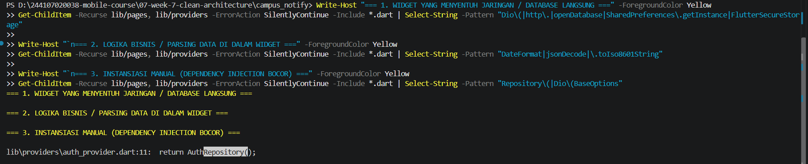
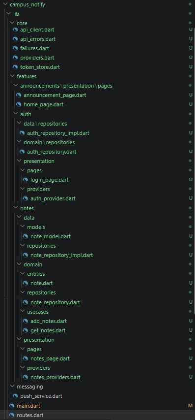
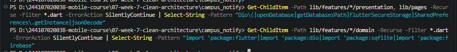
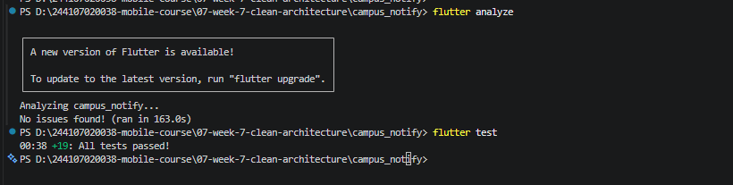
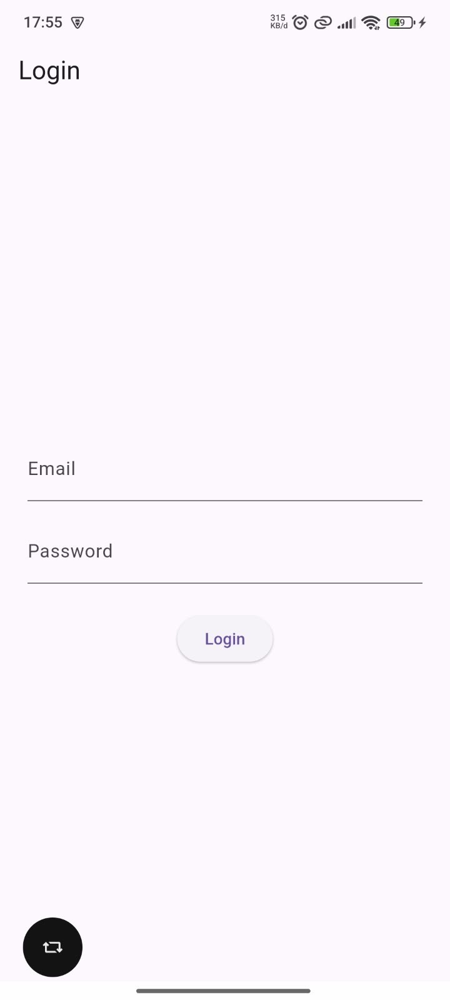
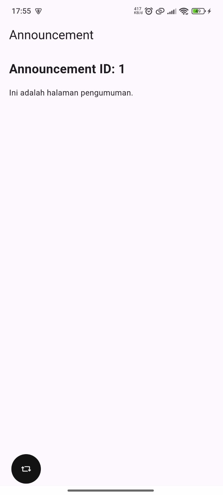

|  | Pemrograman Mobile |
|--|--|
| NIM |  244107020038 |
| Nama |  Nayla Akas Oktavia |
| Kelas | TI - 3H |
| Repository | [link]() |

# WEEK 7
## Clean Architecture

### Praktikum 1 — Audit layer project lama

1. Petakan file ke layer

| File | Layer saat ini | Masalah / Catatan |
| :--- | :--- | :--- |
| `pages/home_page.dart` | presentation | Memanggil `ref.read(authStateProvider.notifier).logout()` dan navigasi `context.go()` langsung di UI. Belum memisahkan logika event handler. |
| `pages/login_page.dart` | presentation | Pengelolaan `TextEditingController`, penanganan state loading/error, dan eksekusi `login()` dilakukan langsung di dalam widget. |
| `pages/announcement_page.dart` | presentation | Menampilkan UI detail pengumuman statis berbasis `id` tanpa integrasi fetching data via repository. |
| `data/api_client.dart` | data | OK bila hanya dipakai repository, bukan widget. |
| `providers/auth_provider.dart` | presentation (state) | OK bila hanya memanggil repository/use case. Namun saat ini masih melakukan instansiasi langsung kelas `AuthRepository()` dan `TokenStore()`. |
| `data/auth_repository.dart` | data (+kontrak tercampur) | Interface dan implementasi masih satu kelas. Masih menggunakan *mock data* dummy. |
| `data/token_store.dart` | data / infrastructure | Mengelola penyimpanan token langsung menggunakan `FlutterSecureStorage`. |
| `data/api_errors.dart` | data / presentation helper | Memetakan exception `DioException` ke pesan teks yang ramah pengguna (*user-friendly*). |
| `messaging/push_service.dart` | infrastructure / data | Menggabungkan logika FCM, local notification, dan parsing rute. |
| `routes.dart` | presentation (routing) | Menyatukan konfigurasi rute `GoRouter` dan helper parsing payload FCM `routeFromMessage`. |
| `main.dart` | application / entry point | Menangani inisialisasi Firebase, FCM background handler, setup `GoRouter`, dan pendaftaran provider root. |

---

2. Tandai tiga pelanggaran klasik

3. Struktur target

### Praktikum 2 — Domain dan data per fitur

1. Buat lib/features/notes/domain/entities/note.dart. Tanpa import Flutter, tanpa mapping
2. Buat lib/core/failures.dart dan lib/features/notes/domain/repositories/note_repository.dart
3. Buat lib/features/notes/data/models/note_model.dart (mapping hanya di sini) dan note_repository_impl.dart
4. Buat lib/features/notes/domain/usecases/get_notes.dart

### Praktikum 3 — Presentation, DI, dan verifikasi

1. Buat lib/features/notes/presentation/providers/notes_providers.dart. Inilah satu-satunya tempat wiring
2. notes_page.dart versi bersih tidak mengandung SQL, Dio, JSON, atau formatting tanggal mentah
3. Jalankan tiga pemeriksaan, semua harus lolos

### AI Challenge

1. Prompt yang dikirimkan ke AI Assistant:
>  Project Flutter saya: campus_notify (auth + FCM + daftar pengumuman).
> Kondisi kini: folder lib/{data, providers, pages, messaging}, repository tercampur dengan implementasi, widget memanggil Dio langsung.
> Tugas:
> 1. Usulkan struktur feature-first Clean Architecture (presentation/domain/data) untuk fitur auth + announcements.
> 2. Untuk tiap file lama, sebutkan tujuan barunya (pindah/pecah/hapus).
> 3. Tandai bagian yang over-engineering bila diterapkan ke CRUD sederhana, dan kapan use case benar-benar dibutuhkan vs repository langsung.
> 4. Tunjukkan wiring DI dengan Riverpod (tanpa package DI tambahan).
> Jelaskan trade-off setiap keputusan.

2. Tabel Usulan AI vs Keputusan Final

| Usulan AI / Aspek | Keputusan Final Kita | Alasan Teknis & Trade-off |
| :--- | :--- | :--- |
| **Pemisahan Interface & Impl** | **Diterima** | `auth_repository.dart` ditaruh di `domain/repositories/` (interface) dan `auth_repository_impl.dart` di `data/repositories/` agar domain steril dari detail infrastruktur. |
| **Penggunaan Use Case** | **Disederhanakan (Ditolak untuk CRUD Sederhana)** | Untuk fitur `announcements` dan `auth` yang berbasis pass-through/CRUD sederhana, Notifier langsung memanggil Repository tanpa Use Case untuk menghindari *over-engineering* dan file boilerplate berlebih. |
| **Wiring Dependency Injection** | **Diterima (Riverpod Native)** | Memanfaatkan `Provider<Repository>` murni dari Riverpod untuk meng-inject dependency tanpa perlu library DI tambahan seperti `get_it`. |
| **Lokasi Helper Database (`openDb`)** | **Disederhanakan** | Fungsi pembuka DB ditaruh langsung di kelas `note_repository_impl.dart` pada layer `data` alih-alih membuat file terpisah `db.dart` agar struktur folder tetap ringkas. |

3.  AI Verification Checklist

* [x] **Interface Repository di `domain` & Implementasi di `data`**:
  - Interface: `lib/features/auth/domain/repositories/auth_repository.dart`
  - Implementasi: `lib/features/auth/data/repositories/auth_repository_impl.dart`
* [x] **Layer `domain` Bebas Framework/Library**:
  - Diperiksa menggunakan PowerShell, tidak ada import `flutter`, `dio`, `sqflite`, atau `firebase` di dalam folder `domain`.
* [x] **Bebas Over-Engineering Use Case**:
  - Operasi CRUD satu-baris langsung ditangani dari Notifier ke Repository (UI -> Notifier -> Repository)
* [x] **Entity Bebas Mapping**:
  - Fungsi `toMap()` / `fromMap()` hanya ada pada `NoteModel` (`data/models`), bukan pada `Note` entity (`domain/entities`)
* [x] **Wiring DI Terpusat di Provider**:
  - Widget UI tidak melakukan instansiasi `new AuthRepository()`, melainkan membaca via `ref.watch(authRepositoryProvider)`

### Refactoring

1. Terapkan pola yang sama ke fitur kedua (auth atau announcements): entity + repository interface + impl + 1 use case + provider wiring. Jangan biarkan satu fitur bersih dan sisanya kotor.
2. Ekstrak formatting tanggal dan parsing rute ke fungsi murni di lib/core/format.dart agar bisa diuji tanpa widget.
3. Pindahkan semua exception mentah menjadi Failure yang ramah pengguna sebelum mencapai UI; UI hanya menerima message.

### Tugas

### Refleksi

1. Mengapa interface repository harus tinggal di domain, bukan di data? Apa yang rusak bila dibalik?

   Domain adalah inti dari logika bisnis dan tidak boleh bergantung pada detail teknis (Database/Network/Framework). Jika dibalik (interface ditaruh di data), layer domain akan terikat pada layer data. Akibatnya, saat database atau library diganti, kode bisnis utama di domain akan ikut rusak dan sulit di-unit test secara independen.

2. Kapan use case benar-benar dibutuhkan, dan kapan repository langsung ke notifier sudah cukup?

   - Butuh Use Case: Saat ada logika bisnis kompleks yang melibatkan gabungan beberapa repository, validasi data khusus, transformasi data, atau pembagian akses peran (roles).

   - Cukup ke Notifier: Saat operasinya sebatas CRUD sederhana (Pass-Through) tanpa aturan bisnis tambahan, misal hanya mengambil list data mentah dari API/DB langsung ke UI.

3. Apa biaya over-engineering (use case per CRUD satu-baris) bagi tim kecil? Kapan biayanya sepadan?

   - Dampak/Biaya: Menambah jumlah file secara berlebihan (boilerplate code), memperlambat proses development, membuat alur pencarian kode rumit (harus buka banyak file hanya untuk 1 fungsi simpel), serta menambah beban maintenance.

   - Sepadan Saat: Aplikasi diprediksi akan terus membesar, tim berkembang pesat, aturan bisnis sangat fleksibel dan sering berubah, atau saat membutuhkan cakupan unit test yang sangat ketat pada setiap aturan bisnis.

4. Bagian mana dari usulan AI yang Anda tolak atau sederhanakan, dan mengapa?

   Penambahan file terpisah untuk helper database (db.dart) atau pemisahan use case satu per satu untuk operasi CRUD yang sangat sederhana. Solusinya disederhanakan dengan menyatukan database opener langsung di kelas implementasi repository (note_repository_impl.dart) agar struktur folder tetap ringkas dan tidak memicu pembuatan file baru yang tidak perlu.