|  | Pemrograman Mobile |
|--|--|
| NIM |  244107020038 |
| Nama |  Nayla Akas Oktavia |
| Kelas | TI - 3H |

# WEEK 8
## Mid Project Review & Code Review

### Praktikum 1 — Hygiene branch dan commit

1. Audit riwayat Anda

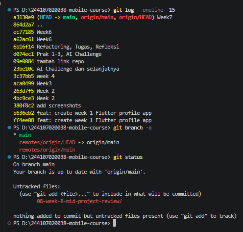

2. Buat branch kerja yang benar

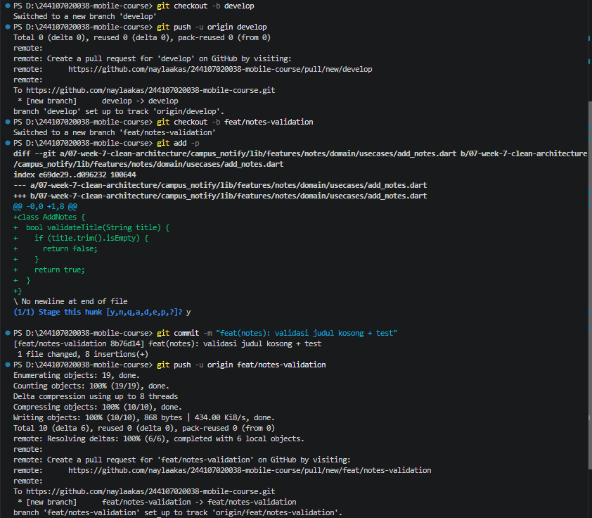

3. Perbaiki satu commit buruk (simulasi)

| Sebelum (Commit Lama) | Sesudah (Format Konvensional) | Alasan |
| :--- | :--- | :--- |
| `..` | `fix(core): perbaikan bug pada navigasi` | Pesan lama tidak menjelaskan perubahan sama sekali. |
| `tambah link repo` | `docs(readme): tambah link repositori proyek` | Menjelaskan jenis perubahan (docs) dan lokasi/aksinya secara spesifik. |
| `Week6` | `feat(assignment): selesaikan tugas praktikum minggu 6` | Pesan lama terlampau umum dan tidak informatif. |

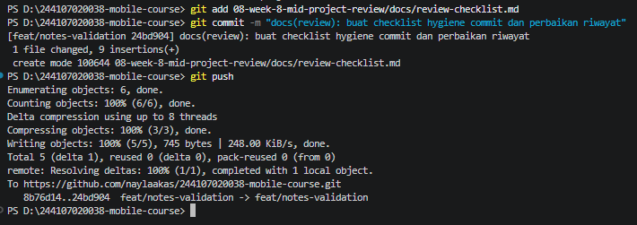

### Praktikum 2 — PR dan peer review

1. Buka PR kecil

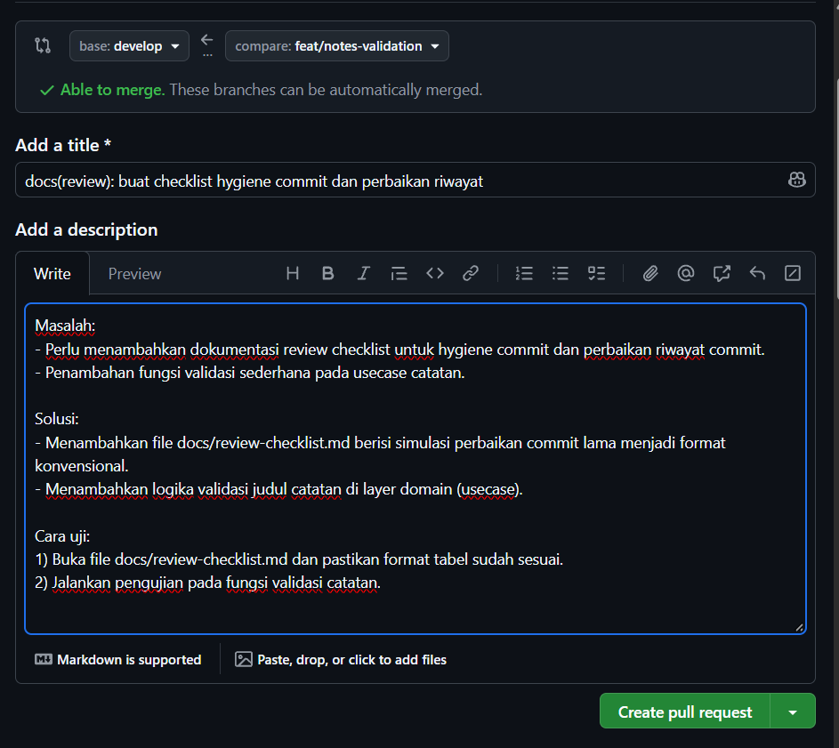

2. Review sejawat 

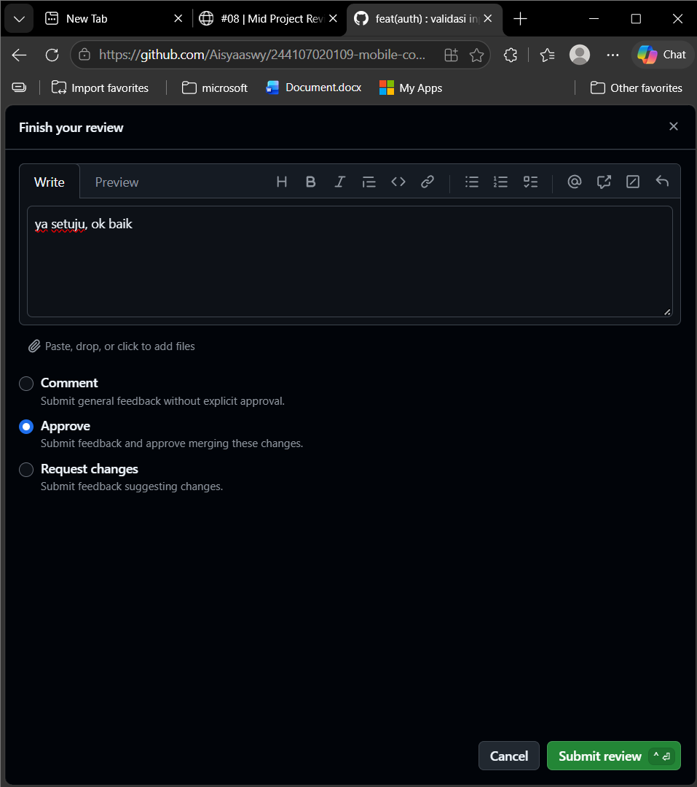

3. Delete branch

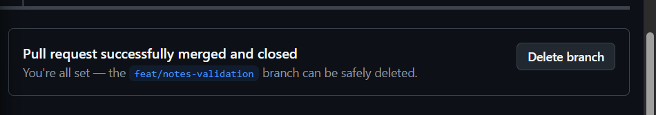

### Praktikum 3 — Static analysis dan mid review

1. Bersihkan dengan mesin

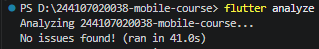

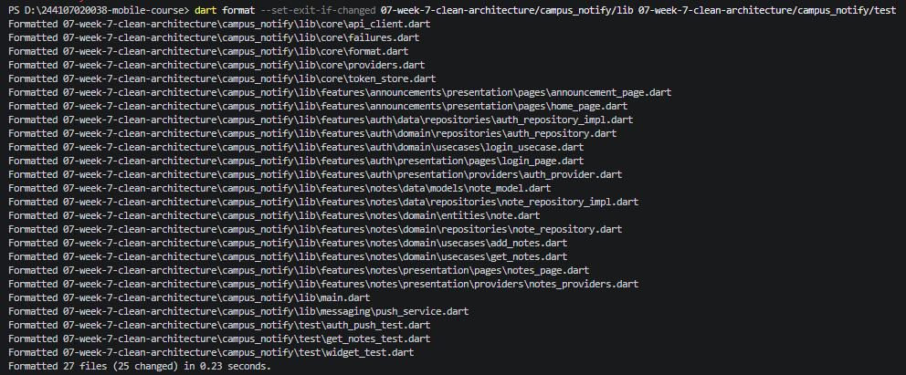

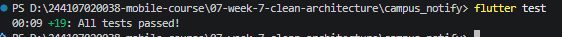

2. Aktifkan penolakan otomatis (CI)

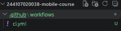

3. Nilai kesiapan tengah semester

- [x] Struktur feature-first terbukti
- [x] Static analysis bersih (`flutter analyze` lulus)
- [x] Test suite hijau (`flutter test` lulus)
- [x] PR kecil + commit message konvensional jelas
- [x] README + screenshot + panduan menjalankan lengkap
- [x] Semua komentar peer review sudah ditindaklanjuti

### AI Challenge

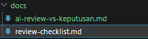

### Refleksi

1. Apa beda LGTM buta dengan approve yang bertanggung jawab? Apa risikonya bagi tim?

    LGTM buta asal klik approve tanpa meriksa kode. Approve bertanggung jawab memeriksa arsitektur, edge case, dan hasil test. Risikonya bug, pelanggaran arsitektur, dan crash lolos ke branch utama (develop/main)

2. Kapan komentar wajib berstatus request changes, dan kapan cukup saran?

    Request Changes untuk blocker seperti crash, unhandled null, tes gagal, atau salah arsitektur. Cukup saran untuk hal minor seperti kerapian kode atau saran refactoring kecil.

3. Bagian mana dari review AI yang Anda tolak atau sederhanakan, dan mengapa?

    Tuduhan impor library data di layer domain (halusinasi AI) dan saran formatting spasi. Alasannya layer domain sudah murni, dan formatting sudah ditangani otomatis oleh dart format/CI

4. Satu hal konkret yang Anda perbaiki setelah review sejawat — apa dampaknya?

    Tidak ada