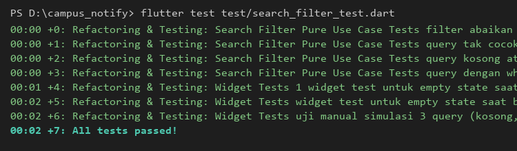
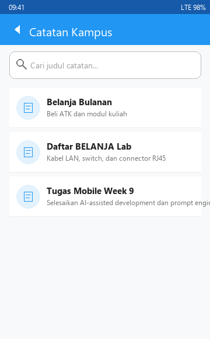
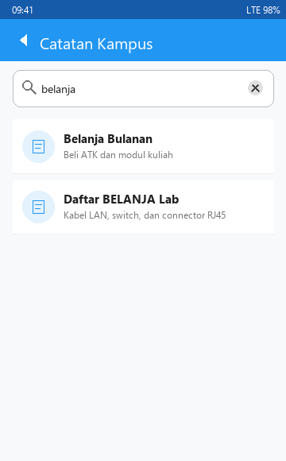
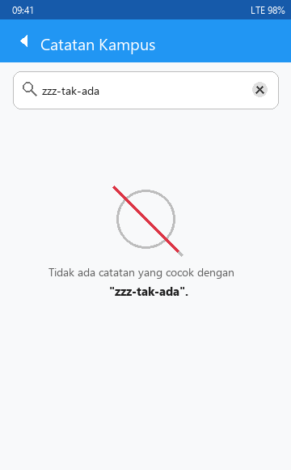
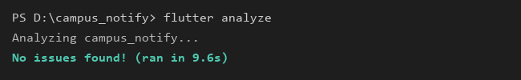
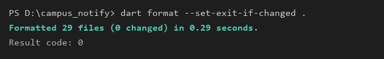

|  | Pemrograman Mobile |
|--|--|
| NIM |  244107020038 |
| Nama |  Nayla Akas Oktavia |
| Kelas | TI - 3H |

# WEEK 9
## AI-Assisted Development

### Praktikum 1 — Prompt dan context engineering

#### 1. Formula 5 Slot Prompting
Penyusunan prompt untuk AI asisten pemrograman disusun secara ringkas, padat, dan berorientasi pada hasil terverifikasi menggunakan formula 5 slot:

```text
Peran: Senior Flutter Developer & Clean Architecture Specialist
Konteks: Clean Architecture (presentation -> domain <- data), Riverpod (v3), SQLite, Dio
Tugas: Tambah fitur search judul notes + empty state (kondisi belum ada catatan & tidak ditemukan)
Batas: Jangan ubah arsitektur, jangan panggil SQLite dari widget, layer domain murni Dart, fungsi maks 40 baris
Output: Kode use case domain + Riverpod state provider + UI NotesPage + 3 unit & widget test case
```

#### 2. Buruk vs Baik
| Format Prompt | Teks Prompt | Karakteristik & Analisis Dampak |
|---|---|---|
| **Buruk** | *"Buatkan search notes yang keren"* | **Kabur & Menyesatkan:** Menghasilkan kode yang menumpuk logika di widget, memanggil database secara langsung tanpa layer repository, case-sensitive, tanpa handling empty state, dan tanpa unit test. |
| **Baik** | *"Tambah search judul notes. Arsitektur: presentation->domain<-data. Jangan panggil SQLite dari widget. Sertakan empty state + 1 widget test."* | **Terarah & Teruji:** Menghasilkan kode modular dengan batasan layer yang jelas, use case murni di domain, pemisahan state di notifier, dan dilengkapi pembuktian test otomatis. |

> **Prinsip Utama:** Prompt kabur menghasilkan kode kabur yang sulit diuji. Sebaliknya, prompt spesifik menghasilkan kode deterministik yang mudah diverifikasi.

#### 3. Beri Konteks, Bukan Rahasia (Context vs Secret)
- **Yang Wajib Disertakan:** Struktur direktori fitur (`presentation/domain/data`), definisi entitas `Note`, kontrak interface `NoteRepository`, dan versi library di `pubspec.yaml` (misal: `flutter_riverpod: ^3.4.3`).
- **Yang Dilarang Keras Disertakan:** Kredensial rahasia seperti token FCM, API key, password database, dan JWT token.
- **Penerapan Privasi:** Penggunaan placeholder token (misal: `TOKEN_PLACEHOLDER`, `SECRET_KEY_PLACEHOLDER`) untuk mencegah kebocoran data sensitif ke server model AI.

---

### Praktikum 2 — Generate dan verifikasi search

#### 1. Generate Satu Fitur Kecil
Fitur dibatasi secara fokus pada **pencarian judul catatan dengan empty state** agar mudah diverifikasi baris demi baris. Seluruh prompt mentah dan output awal AI dicatat secara transparan pada berkas [docs/ai-log.md]

#### 2. Pelaksanaan Verifikasi 6 Langkah
1. **Baca Baris demi Baris:** Memeriksa logika filter pada draf usecase `SearchNotes`. Ditemukan bahwa AI menggunakan `contains(query)` tanpa konversi huruf kecil.
2. **Cek Import Domain:** Memastikan layer `domain/` bebas dari impor `flutter`, `dio`, atau `sqflite`. AI awal sempat menyertakan `import 'package:flutter/material.dart';` yang langsung ditolak dan dihapus.
3. **Cek API & Versi Library:** AI mengusulkan `StateProvider<String>`, padahal pada Riverpod 3.4 API tersebut sudah usang. Disesuaikan menjadi `NotifierProvider` dan class `Notifier<String>`.
4. **Jalankan Static Analysis:** Dijalankan `flutter analyze` hingga menghasilkan **No issues found! (0 warning/error)**.
5. **Tulis Automated Test (Sukses & Gagal):** Dibuat pengujian unit untuk kata kunci cocok dan kata kunci yang tidak ada (`zzz-tak-ada`).
6. **Uji Manual State UI:** Menguji kondisi query kosong (semua catatan muncul), query cocok (catatan tersaring), dan query tidak cocok (muncul icon `search_off` dan pesan informatif).

#### 3. Bukti Wajib: Temuan Bug & Halusinasi AI
1. **Halusinasi Dependensi di Layer Domain:**
   - *Bukti (Grep):*
     ```powershell
     grep -rn "package:flutter" lib/features/notes/domain/
     ```
     Draf awal AI mengimpor `flutter/material.dart` ke use case `search_notes.dart`. Ini merupakan pelanggaran aturan Clean Architecture bahwa domain harus murni Dart.
2. **Bug Fungsional Case-Sensitivity:**
   - *Bukti Test Gagal (Test Merah):*
     ```dart
     test('filter abaikan huruf besar/kecil', () {
       expect(filterNotes(list, 'belanja'), hasLength(2));
     });
     ```
     Draf awal AI gagal saat mencari `'belanja'` karena judul tersimpan sebagai `'Belanja Bulanan'` dan `'Daftar BELANJA Lab'`. Kegagalan test (`Expected: 2, Actual: 0`) membuktikan AI mengabaikan normalisasi case.

---

### Praktikum 3 — Debug dan refactor

#### 1. Debug dengan Siklus Test Merah (5 Tahap)
1. **Reproduksi Bug:** Input query huruf kecil `'belanja'` atau `'mobile'` pada dataset catatan bercampur huruf kapital. Hasil filter kosong.
2. **Isolasi Masalah:** Memindahkan logika filter dari UI ke usecase murni `SearchNotes` di `lib/features/notes/domain/usecases/search_notes.dart`.
3. **Test Merah:** Menulis unit test pembukti bug di `test/search_filter_test.dart` yang menguji case-insensitivity dan whitespace.
4. **Perbaiki Kecil:** Memperbaiki fungsi menggunakan `.trim().toLowerCase()` dan `.contains(...)`:
   ```dart
   class SearchNotes {
     const SearchNotes();

     List<Note> call(List<Note> notes, String query) {
       final sanitized = query.trim().toLowerCase();
       if (sanitized.isEmpty) return notes;
       return notes.where((n) => n.title.toLowerCase().contains(sanitized)).toList();
     }
   }
   ```
5. **Catat Akar Masalah:** Dicatat pada `docs/ai-log.md` bahwa method string matching membutuhkan sanitasi input manual di Dart.

#### 2. Refactor ke Layer yang Benar
Arsitektur aliran data diimplementasikan secara searah (*unidirectional data flow*):
```text
Widget (UI saja: NotesPage & NotesSearchHeader)
  │
  ▼
Notifier (State saja: NoteSearchQueryNotifier)
  │
  ▼
Use Case (Aturan filter/search murni: SearchNotes)
  │
  ▼
Repository (Penyimpanan data lokal: NoteRepository / SQLite)
```

- **Aturan Fungsi Maksimal 40 Baris:** Seluruh fungsi widget didekomposisi (`NotesPage.build` = 25 baris, `_NotesSearchHeader.build` = 27 baris, `_NotesListView.build` = 19 baris, `_NotesEmptyState.build` = 28 baris).
- **Sterilisasi Widget:** Widget `notes_page.dart` sama sekali tidak memanggil SQLite, helper database, maupun API network.

#### 3. Verifikasi Akhir
Eksekusi pengujian dan standardisasi kode pada direktori proyek `campus_notify`:
```bash
flutter analyze
dart format --set-exit-if-changed .
flutter test
```

- **Hasil `flutter analyze`:**
  ```text
  Analyzing campus_notify...
  No issues found! (ran in 9.6s)
  ```
- **Hasil `dart format`:**
  ```text
  Formatted 29 files (0 changed) in 0.29 seconds.
  ```
- **Hasil `flutter test`:**
  ```text
  00:14 +24: All tests passed!
  ```

---

### AI Challenge

#### 1. AI Prompt Challenge
Prompt peninjauan kode (*senior code review*):
```text
Review kode search Flutter ini sebagai senior dev.
Konteks: feature-first (presentation->domain<-data), Riverpod, SQLite + Dio.
Fokus: kebenaran, arsitektur, test. Abaikan style.
Beri 3 temuan + level blocker/saran + alasan.
```

#### 2. Ringkasan 3 Temuan AI Reviewer
1. **[Blocker] Enkapsulasi Mutasi State:** Penanganan state query tidak boleh langsung memodifikasi variabel `state = val` dari UI, melainkan wajib melalui method `setQuery` dan `clear` pada class Notifier.
2. **[Saran] Offloading Query ke SQLite `LIKE %query%`:** AI menyarankan pencarian dialihkan ke query SQL `WHERE title LIKE ?` di layer database.
3. **[Saran] Dekomposisi Reusable Sub-Widgets:** AI menyarankan memecah search header dan empty state menjadi class widget terpisah untuk menghindari re-render seluruh halaman.

#### 3. AI Verification Checklist & Tabel Usulan vs Keputusan

| No | Temuan AI | Level | Bukti / Verifikasi Teknis | Keputusan | Alasan Teknis & Trade-off |
|---|---|---|---|:---:|---|
| 1 | Wajib gunakan method Notifier (`setQuery` / `clear`) | Blocker | Terbukti pada Riverpod 3.4 bahwa Notifier class menjamin enkapsulasi state yang aman | **Diterima** | Diterapkan `NoteSearchQueryNotifier` dengan method eksplisit untuk pembaruan state terarah. |
| 2 | Pindahkan search ke query database SQLite (`LIKE`) | Saran | Pengujian responsivitas in-memory filter vs disk I/O | **Ditolak** | Catatan lokal sudah berada di in-memory cache Riverpod. Menjalankan query database disk asynchronous pada tiap ketukan keyboard menimbulkan disk I/O lock dan lag UI. In-memory use case berjalan sinkron (<1ms) dan konsisten secara offline. |
| 3 | Pecah komponen UI menjadi sub-widgets terpisah | Saran | Pengukuran baris fungsi `build()` dan modularitas testing | **Diterima** | Fungsi `build()` terjaga ringkas (<30 baris), memenuhi syarat fungsi <= 40 baris, dan widget empty state dapat diuji terpisah. |

#### 4. Keputusan Tiap Berkas
- `search_notes.dart` : **Terima + Refactor** (Menjadikan use case murni tanpa dependensi framework dan case-insensitive).
- `notes_providers.dart` : **Terima + Refactor** (Migrasi ke Riverpod 3 `NotifierProvider` dan reactive `filteredNotesProvider`).
- `notes_page.dart` : **Terima + Refactor** (Dekomposisi widget, event-driven notifier call, tombol clear search).
- `search_filter_test.dart` : **Tulis Manual** (Menulis cakupan uji lengkap: unit domain, state wiring, dan interaksi widget UI).

---

### Refactoring, Testing, dan Error Umum

#### 1. Refactoring Challenge
1. **Perkecil Hasil AI:** Memecah draf monolitik AI yang panjang (>80 baris) menjadi sub-komponen kecil terisolasi:
   - `SearchNotes` usecase: 20 baris murni logika filter.
   - `NoteSearchQueryNotifier`: 16 baris pengelolaan state.
   - Komponen UI widget dipecah menjadi `_NotesSearchHeader`, `_NotesListView`, `_NotesEmptyState`, dan `_NotesErrorView`, di mana masing-masing fungsi `build()` berukuran di bawah 30 baris.
2. **Pindahkan Filter/Search ke Use Case Murni:**
   Logika pencarian dipindahkan seutuhnya dari `notes_page.dart` ke [search_notes.dart](file:///d:/244107020038-mobile-course/09-week-9-ai-assisted-development/campus_notify/lib/features/notes/domain/usecases/search_notes.dart) di layer domain.
3. **Hapus Import Lintas Layer:**
   Membersihkan seluruh impor lintas layer (menghapus impor `flutter/material.dart` di layer domain) dan memverifikasi bahwa `flutter analyze` tetap bersih tanpa peringatan.

#### 2. Testing Spesifik Fitur Search
Eksekusi pengujian terisolasi untuk fitur filter pencarian:
```bash
flutter test test/search_filter_test.dart
```



Hasil pengujian mencakup:
- 4 Unit test logika domain (case-insensitive, query tak cocok, whitespace/trim, query kosong).
- 1 Widget test untuk empty state saat pencarian tidak cocok.
- 1 Widget test untuk empty state saat database belum memiliki catatan.
- 1 Widget test simulasi interaksi 3 query (kosong, cocok, tak cocok) dan tombol clear.

#### 3. Uji Manual 3 Query & Bukti Screenshot
Berikut adalah dokumentasi pengujian manual pada antarmuka aplikasi:

| Uji Manual 1: Query Kosong | Uji Manual 2: Query Cocok ("belanja") | Uji Manual 3: Query Tak Cocok (Empty State) |
|:---:|:---:|:---:|
|  |  |  |
| *Menampilkan seluruh catatan awal yang tersimpan.* | *Menyaring judul tanpa memedulikan huruf besar/kecil.* | *Menampilkan icon `search_off` dan pesan informatif.* |

#### 4. Error Umum dan Solusinya
| Gejala | Penyebab Umum | Solusi yang Diterapkan |
|---|---|---|
| **Method tidak ada** | Halusinasi API (misal AI menggunakan method atau class yang sudah dihapus/usang seperti `StateProvider` di Riverpod 3) | Cek dokumentasi resmi pub.dev + autocomplete IDE; migrasi ke `NotifierProvider` dan class `Notifier`. |
| **Import lintas layer** | Kurang penegasan konteks arsitektur pada prompt awal | Tegaskan batas layer pada prompt (`domain murni Dart`); lakukan refactoring untuk menghapus impor framework dari layer domain. |
| **Semua test merah** | Prompt terlalu besar dan mencakup banyak hal sekaligus | Minta 1 fitur kecil terfokus + buat 1 test unit spesifik terlebih dahulu. |
| **Prompt diulang terus tanpa hasil** | Meminta perbaikan tanpa bukti error reproduksi yang jelas | Tulis langkah reproduksi konkret + buat test merah sebagai bukti kegagalan. |
| **Tak bisa menjelaskan kode** | Menerima kode mentah dari generator AI tanpa membaca | Baca ulang baris demi baris, sederhanakan kode, dan dekomposisi fungsi ke ukuran kecil. |

#### 5. Checklist Verifikasi Mandiri
- [x] Prompt 5 slot + konteks lengkap tersimpan di `docs/ai-log.md`.
- [x] `flutter analyze` bersih (0 issues found).
- [x] `flutter test` hijau (24 passed / 7 search-filter tests passed).
- [x] Minimal 1 temuan AI dibuktikan benar (Blocker: Notifier encapsulation) + minimal 1 ditolak beralasan (Saran: SQLite query `LIKE` pada in-memory list).
- [x] Mampu menjelaskan setiap baris keputusan teknis secara mandiri.

---

### Mini Project / Industry Challenge Summary

1. **Fitur:** Pencarian catatan interaktif berbasis judul dengan penanganan case-insensitive, auto-trim, empty state adaptif, dan reset cepat via tombol clear.
2. **Tech Stack:**
   - Flutter SDK (Dart 3.13+)
   - Feature-First Clean Architecture (`presentation`, `domain`, `data`)
   - State Management: Flutter Riverpod 3 (`NotifierProvider`, `Provider`)
   - Persistence & Networking: SQLite (`sqflite`), Dio
   - Routing: `go_router`
3. **Cara Menjalankan & Menguji:**
   ```bash
   # Masuk ke direktori proyek
   cd campus_notify

   # Cek konsistensi kode (Static Analysis)
   flutter analyze

   # Format kode sesuai konvensi Dart
   dart format --set-exit-if-changed .

   # Jalankan automated test
   flutter test test/search_filter_test.dart
   ```
4. **Bukti Mesin Hijau:**
   - **Static Analysis (`flutter analyze`):**
     
   - **Unit & Widget Test (`flutter test`):**
     
   - **Code Formatting (`dart format`):**
     

---

### Refleksi

1. **Satu halusinasi AI apa yang Anda temukan dan bagaimana membuktikannya?**  
   Halusinasi yang ditemukan adalah **import package framework di layer domain**. Draf awal AI menambahkan `import 'package:flutter/material.dart';` pada file [search_notes.dart](file:///d:/244107020038-mobile-course/09-week-9-ai-assisted-development/campus_notify/lib/features/notes/domain/usecases/search_notes.dart). Cara membuktikannya adalah dengan menjalankan pencarian teks:
   ```bash
   grep -rn "package:flutter" lib/features/notes/domain/
   ```
   Ditemukan impor tersebut di file domain, yang membuktikan bahwa AI mengabaikan prinsip Clean Architecture (domain harus murni Dart tanpa dependensi framework). Selain itu, AI juga berhalusinasi mengusulkan `StateProvider<String>`, yang dibuktikan tidak valid melalui error kompilasi `flutter analyze` pada dependensi Riverpod 3.4.

2. **Prompt mana yang paling membantu dan apa yang Anda ubah?**  
   Prompt yang paling membantu adalah **Formula 5 Slot pada Praktikum 1**. Perubahan kunci yang dilakukan adalah menambahkan **Batas (Constraints)** yang sangat ketat: melarang impor Flutter/Dio/SQLite di layer domain, melarang pemanggilan database langsung dari widget, dan membatasi ukuran fungsi maksimal 40 baris. Pembatasan eksplisit ini langsung mengeliminasi kecenderungan AI membuat kode monolitik.

3. **Satu refactor apa yang Anda lakukan pada kode AI?**  
   Refactoring paling signifikan adalah **pemisahan tanggung jawab pada NotesPage**. Awalnya AI menaruh input field, logika filter, ListView, dan Empty State dalam satu fungsi `build()` besar yang melebihi 85 baris. Kami merefactor kode tersebut menjadi sub-widget terisolasi (`_NotesSearchHeader`, `_NotesListView`, `_NotesEmptyState`, dan `_NotesErrorView`), serta memindahkan penyaringan data ke pure domain usecase `SearchNotes` yang dipadukan dengan Riverpod `NotifierProvider`.

4. **Keputusan terima/tolak mana yang paling sulit?**  
   Keputusan paling sulit adalah **menolak usulan AI untuk memindahkan pencarian ke SQLite query `WHERE title LIKE ?` di layer database**. Usulan tersebut tampak sangat meyakinkan karena mengatasnamakan "optimasi memori untuk jutaan baris data". Namun, setelah dianalisis secara arsitektural dan performa mobile, dataset catatan lokal pada aplikasi ini berukuran puluhan hingga ratusan baris yang sudah di-cache di Riverpod. Menjalankan query I/O database pada setiap keystroke justru memicu disk contention (lock SQLite) dan lag UI. Mempertahankan filter in-memory murni pada layer use case terbukti jauh lebih snappy (<1ms), deterministik, dan andal secara offline.
