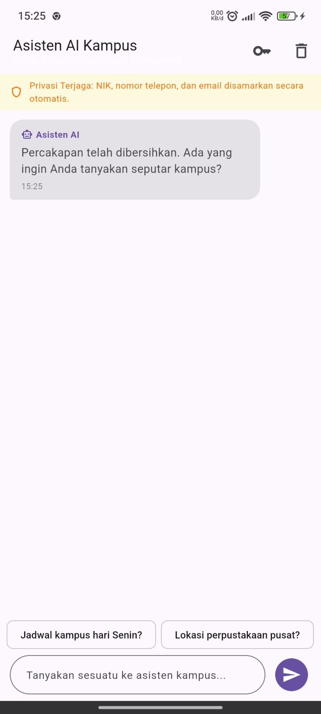
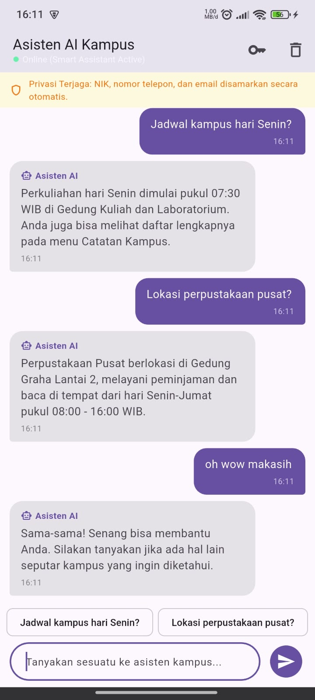
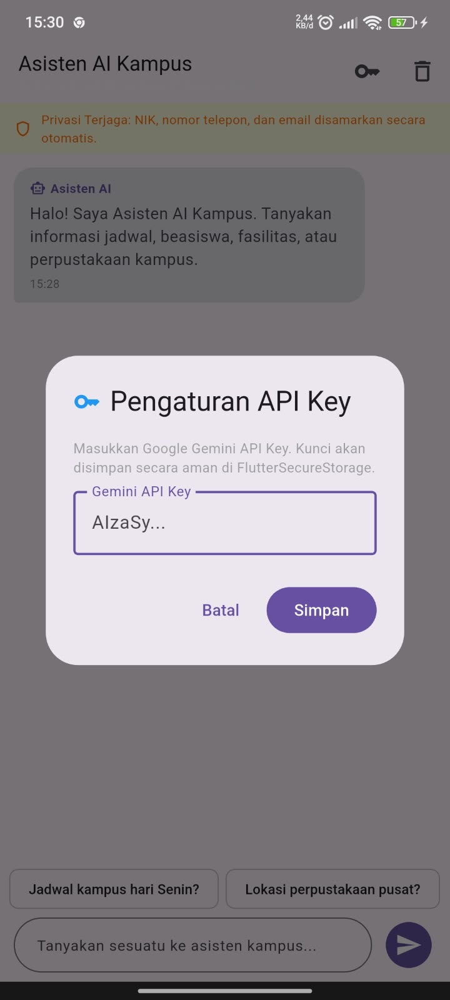
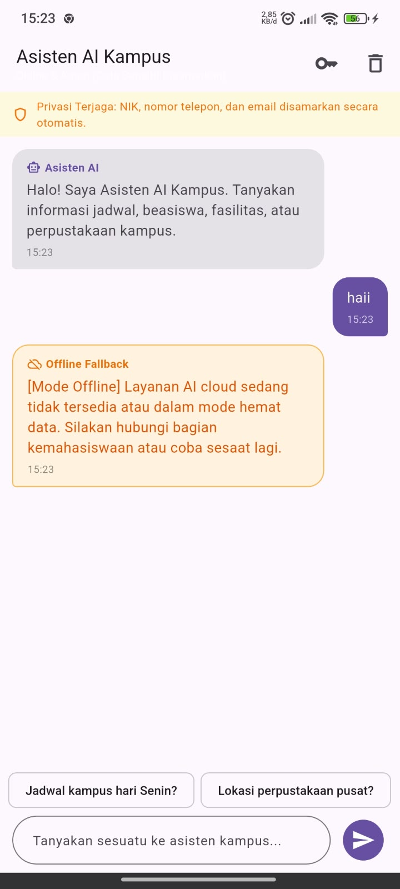

|  | Pemrograman Mobile |
|--|--|
| **NIM** | 244107020038 |
| **Nama** | Nayla Akas Oktavia |
| **Kelas** | TI - 3H |

# WEEK 10
## Integrasi Fitur AI (Mobile AI Feature Integration)

### Praktikum: Chat Interface dengan AI

#### Langkah 1: Tambahkan Dependensi
Dependensi ditambahkan pada `campus_notify/pubspec.yaml`:
```yaml
dependencies:
  flutter:
    sdk: flutter
  cupertino_icons: ^1.0.8
  flutter_riverpod: ^3.4.3
  go_router: ^18.0.2
  dio: ^5.11.1
  sqflite: ^2.3.0
  flutter_secure_storage: ^11.2.0
  http: ^1.2.0
```

#### Langkah 2: Buat AI Service
Berkas dibuat di [lib/ai/ai_service.dart](campus_notify/lib/ai/ai_service.dart) dengan kapabilitas:
- Pembacaan API Key dari `FlutterSecureStorage` (key: `ai_api_key`).
- Sanitasi input otomatis (`sanitizeInput`) menggunakan Regex untuk menyamarkan NIK, No HP, dan Email.
- Pemanggilan REST API Google Gemini endpoint (`generativelanguage.googleapis.com/v1beta/models/gemini-1.5-flash:generateContent`).
- Penyimpanan cache in-memory untuk pertanyaan identik.
- Mode offline / local fallback jika API mengalami gangguan atau kunci belum disetel.

Cuplikan implementasi utama `AiService`:
```dart
class AiService {
  final FlutterSecureStorage _storage;
  final http.Client _client;
  final String _apiUrl;
  final String _systemPrompt;
  final Map<String, String> _cache = {};

  Future<String> ask(String question, {bool useCache = true, bool allowFallback = true}) async {
    final sanitizedQuestion = sanitizeInput(question);
    final cacheKey = sanitizedQuestion.trim().toLowerCase();

    // 1. Cek Cache Lokal
    if (useCache && _cache.containsKey(cacheKey)) {
      return _cache[cacheKey]!;
    }

    // 2. Baca API Key dari Secure Storage
    final apiKey = await _storage.read(key: 'ai_api_key');
    if (apiKey == null || apiKey.trim().isEmpty) {
      if (allowFallback) return getFallbackResponse(sanitizedQuestion);
      throw Exception('API key tidak tersedia. Silakan atur di pengaturan.');
    }

    // 3. Panggil Cloud AI Endpoint
    try {
      final response = await _client.post(
        Uri.parse('$_apiUrl?key=$apiKey'),
        headers: {'Content-Type': 'application/json'},
        body: jsonEncode({
          'system_instruction': {'parts': [{'text': _systemPrompt}]},
          'contents': [{'parts': [{'text': sanitizedQuestion}]}]
        }),
      );

      if (response.statusCode == 200) {
        final data = jsonDecode(response.body);
        final text = data['candidates'][0]['content']['parts'][0]['text']?.toString().trim() ?? '';
        _cache[cacheKey] = text;
        return text;
      } else {
        if (allowFallback) return getFallbackResponse(sanitizedQuestion);
        throw Exception('Gagal memanggil AI API: ${response.statusCode}');
      }
    } catch (e) {
      if (allowFallback) return getFallbackResponse(sanitizedQuestion);
      rethrow;
    }
  }
}
```

#### Langkah 3: Buat Chat Screen
Berkas dibuat di [lib/features/chat_screen.dart](campus_notify/lib/features/chat_screen.dart) dengan antarmuka lengkap:
1. **Banner Privasi Terjaga:** Menampilkan jaminan visual bahwa NIK, nomor telepon, dan email disamarkan secara otomatis.
2. **Gelembung Pesan Terstruktur:** Membedakan pesan mahasiswa (warna primer tema, rata kanan) dan asisten AI (warna kontras, ikon robot, rata kiri).
3. **Indikator Loading:** Menampilkan animasi pengetikan asisten saat request sedang diproses.
4. **Quick Suggestion Chips:** Tombol pertanyaan cepat ("Jadwal kampus hari Senin?", "Lokasi perpustakaan pusat?", "Info beasiswa kampus?").
5. **Modal Dialog API Key:** Pengguna dapat memasukkan atau menghapus Gemini API Key pribadi yang tersimpan secara aman di `FlutterSecureStorage`.
6. **Graceful Fallback Dialog:** Menampilkan `AlertDialog` saat layanan AI sibuk atau kuota habis dengan opsi beralih ke Mode Offline.

### Verification & Tests

#### A. Static Analysis (`flutter analyze`)
```bash
cd campus_notify
flutter analyze
```


#### B. Code Formatting (`dart format`)
```bash
cd campus_notify
dart format --set-exit-if-changed .
```


#### C. Automated Testing Suite (`flutter test`)
```bash
cd campus_notify
flutter test
```


### Privasi, Biaya, Error Handling, dan Fallback

#### Tabel Risiko dan Mitigasi
| No | Potensi Risiko | Mitigasi yang Diterapkan pada Kode |
|:---:|---|---|
| 1 | **Bocor Data Pengguna** | Menerapkan method `AiService.sanitizeInput()` sebelum payload dikirim ke jaringan. NIK 16-digit diubah menjadi `[NIK_DISAMARKAN]`, No HP diubah menjadi `[NO_HP_DISAMARKAN]`, dan email diubah menjadi `[EMAIL_DISAMARKAN]`. Kunci API disimpan terenkripsi di `FlutterSecureStorage`. |
| 2 | **Biaya Melonjak** | Mengimplementasikan `_cache` in-memory sehingga pertanyaan identik tidak memicu pemanggilan API kedua. Diberlakukan pembatasan kuota harian `dailyRequestLimit = 30 request/hari`. |
| 3 | **API Error / Cloud Down** | Menyediakan graceful fallback `getFallbackResponse()` dengan basis data lokal kampus dan memunculkan dialog ramah pengguna (`AlertDialog` "Layanan AI Sibuk") serta opsi Mode Offline. |
| 4 | **Respons Tidak Relevan** | Membatasi perilaku AI melalui `system_instruction` tegas: *"Jawab dalam Bahasa Indonesia, maksimal 2 kalimat, ringkas dan sopan. Jangan meminta data pribadi."* |

### Dokumentasi Antarmuka Aplikasi 

| Tampilan Awal Chat & Banner Privasi | Percakapan AI & Sanitasi NIK |
|:---:|:---:|
|  |  |

| Pengaturan API Key (Secure Storage) | Penanganan Error & Offline Fallback |
|:---:|:---:|
|  |  |

### Refleksi

1. Fitur AI mana yang Anda integrasikan dan mengapa?

Saya mengintegrasikan fitur Chat AI karena dapat membantu pengguna memperoleh informasi dan jawaban atas pertanyaan dengan cepat. Fitur ini juga mudah digunakan dan dapat meningkatkan interaktivitas aplikasi.

2. Bagaimana Anda melindungi privasi pengguna saat menggunakan AI API? 
   
Saya tidak mengirimkan data pribadi atau informasi sensitif pengguna ke AI API. API key disimpan secara aman menggunakan flutter_secure_storage, bukan langsung di dalam kode sumber. Saya juga menerapkan validasi input dan membatasi data yang dikirimkan.

3. Fallback apa yang Anda sediakan jika layanan AI error? 
   
Jika layanan AI mengalami error, aplikasi menampilkan pesan yang ramah dan memberikan opsi untuk mencoba kembali. Jika memungkinkan, aplikasi juga menyediakan jawaban dari cache lokal atau mode offline.

4. Satu hal yang Anda pelajari tentang UX fitur AI di mobile?  

Saya belajar bahwa fitur AI di aplikasi mobile harus memiliki antarmuka yang sederhana, respons yang cepat, indikator loading, dan pesan error yang jelas agar pengguna merasa nyaman dan tidak bingung saat menggunakan fitur tersebut.   

