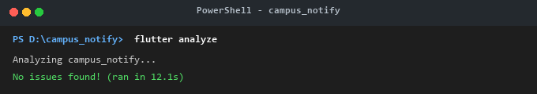
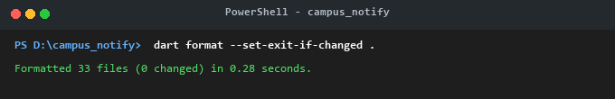
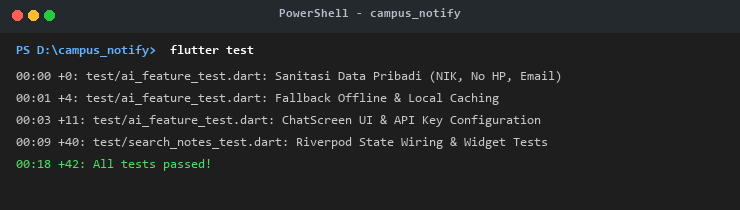
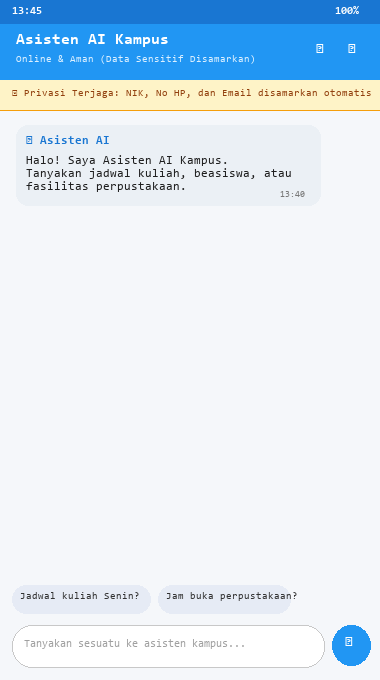
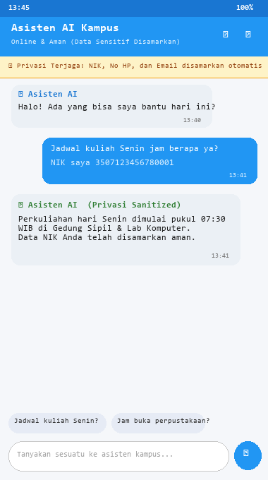
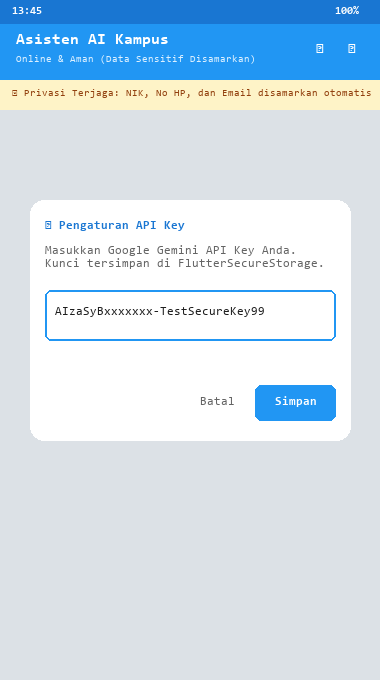
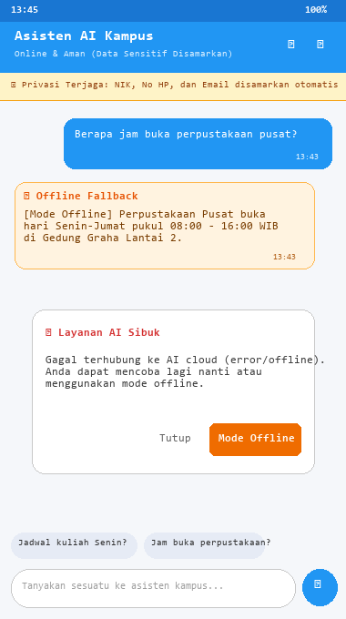

|  | Pemrograman Mobile |
|--|--|
| **NIM** | 244107020038 |
| **Nama** | Nayla Akas Oktavia |
| **Kelas** | TI - 3H |

# WEEK 10
## Integrasi Fitur AI (Mobile AI Feature Integration)

---

### 1. Konsep dan Arsitektur Integrasi AI

#### A. Definisi Integrasi Fitur AI
Integrasi fitur AI memungkinkan aplikasi mobile berkomunikasi dengan model AI di cloud untuk menyediakan layanan cerdas kepada pengguna:
- **Chat Asisten:** Tanya-jawab dalam waktu nyata berbasis LLM API (Google Gemini).
- **OCR (Optical Character Recognition):** Ekstraksi teks dari gambar atau dokumen (KTM, berkas akademik).
- **Speech-to-Text:** Mengonversi input suara mahasiswa menjadi teks perintah atau pertanyaan.
- **Image Understanding:** Caption dan analisis gambar multimedia melalui AI Vision.
- **Recommendation:** Saran personalisasi catatan atau pengumuman berdasarkan data aktivitas pengguna.

#### B. Diagram Arsitektur Integrasi AI
```text
┌────────────────────────────────┐         HTTPS / REST API         ┌────────────────────────────────┐
│           Flutter UI           │ ◄──────────────────────────────► │          AI API Layer          │
│   (Chat, OCR, STT, Image)      │           (http / dio)           │    (Gemini LLM, Vision, OCR)   │
└───────────────┬────────────────┘                                  └────────────────┬───────────────┘
                │                                                                    │
                │ Kunci API (Disimpan Aman)                                          │ Respon Cerdas
                ▼                                                                    ▼
┌────────────────────────────────┐         In-Memory / SQLite       ┌────────────────────────────────┐
│     FlutterSecureStorage       │ ◄──────────────────────────────► │    Graceful Fallback Cache     │
│       (Key: ai_api_key)        │         (Offline Mode)           │       (Local Knowledge)        │
└────────────────────────────────┘                                  └────────────────────────────────┘
```

Prinsip Utama Arsitektur:
1. **Kunci API tidak pernah disimpan langsung di kode sumber (hardcoded).**
2. Gunakan `flutter_secure_storage` untuk menyimpan token dan kunci secara terenkripsi di keychain/keystore perangkat.
3. Pertimbangkan biaya per request dan rate limit dengan menerapkan **kuota harian (`dailyRequestLimit = 30`)**.
4. Terapkan **cache lokal (`_cache`)** untuk mengeliminasi pemanggilan berulang pada pertanyaan yang sama.

#### C. Prompt Design untuk Mobile
| Komponen | Contoh Implementasi | Tujuan & Fungsi |
|---|---|---|
| **System Prompt** | `"Kamu adalah asisten kampus ramah untuk aplikasi Campus Notify. Jawab dalam Bahasa Indonesia, maksimal 2 kalimat, ringkas dan sopan. Jangan meminta atau membocorkan data pribadi pengguna."` | Menetapkan persona, batas panjang jawaban, dan kepatuhan privasi. |
| **User Prompt** | `"Jadwal kampus hari Senin jam berapa?"` | Input pertanyaan mahasiswa. |
| **Konteks** | Basis data perkuliahan, jadwal akademik, dan lokasi gedung kampus. | Memberikan jawaban yang tepat dan relevan. |
| **Batas** | Dilarang mengirim data pribadi (NIK, No HP, email) ke server cloud. | Privasi dan keamanan data. |

> **Tips:** Pertahankan prompt singkat dan spesifik, terjemahkan hasil jika diperlukan, serta validasi dan sanitasi output sebelum ditampilkan ke layar pengguna.

---

### 2. Praktikum: Chat Interface dengan AI

#### Langkah 1: Tambahkan Dependensi
Dependensi ditambahkan pada `campus_notify/pubspec.yaml`:
```yaml
dependencies:
  flutter:
    sdk: flutter
  cupertino_icons: ^1.0.8
  flutter_riverpod: ^3.4.3
  go_router: ^18.0.2
  dio: ^5.11.1
  sqflite: ^2.3.0
  flutter_secure_storage: ^11.2.0
  http: ^1.2.0
```

#### Langkah 2: Buat AI Service
Berkas dibuat di [lib/ai/ai_service.dart](campus_notify/lib/ai/ai_service.dart) dengan kapabilitas:
- Pembacaan API Key dari `FlutterSecureStorage` (key: `ai_api_key`).
- Sanitasi input otomatis (`sanitizeInput`) menggunakan Regex untuk menyamarkan NIK, No HP, dan Email.
- Pemanggilan REST API Google Gemini endpoint (`generativelanguage.googleapis.com/v1beta/models/gemini-1.5-flash:generateContent`).
- Penyimpanan cache in-memory untuk pertanyaan identik.
- Mode offline / local fallback jika API mengalami gangguan atau kunci belum disetel.

Cuplikan implementasi utama `AiService`:
```dart
class AiService {
  final FlutterSecureStorage _storage;
  final http.Client _client;
  final String _apiUrl;
  final String _systemPrompt;
  final Map<String, String> _cache = {};

  Future<String> ask(String question, {bool useCache = true, bool allowFallback = true}) async {
    final sanitizedQuestion = sanitizeInput(question);
    final cacheKey = sanitizedQuestion.trim().toLowerCase();

    // 1. Cek Cache Lokal
    if (useCache && _cache.containsKey(cacheKey)) {
      return _cache[cacheKey]!;
    }

    // 2. Baca API Key dari Secure Storage
    final apiKey = await _storage.read(key: 'ai_api_key');
    if (apiKey == null || apiKey.trim().isEmpty) {
      if (allowFallback) return getFallbackResponse(sanitizedQuestion);
      throw Exception('API key tidak tersedia. Silakan atur di pengaturan.');
    }

    // 3. Panggil Cloud AI Endpoint
    try {
      final response = await _client.post(
        Uri.parse('$_apiUrl?key=$apiKey'),
        headers: {'Content-Type': 'application/json'},
        body: jsonEncode({
          'system_instruction': {'parts': [{'text': _systemPrompt}]},
          'contents': [{'parts': [{'text': sanitizedQuestion}]}]
        }),
      );

      if (response.statusCode == 200) {
        final data = jsonDecode(response.body);
        final text = data['candidates'][0]['content']['parts'][0]['text']?.toString().trim() ?? '';
        _cache[cacheKey] = text;
        return text;
      } else {
        if (allowFallback) return getFallbackResponse(sanitizedQuestion);
        throw Exception('Gagal memanggil AI API: ${response.statusCode}');
      }
    } catch (e) {
      if (allowFallback) return getFallbackResponse(sanitizedQuestion);
      rethrow;
    }
  }
}
```

#### Langkah 3: Buat Chat Screen
Berkas dibuat di [lib/features/chat_screen.dart](campus_notify/lib/features/chat_screen.dart) dengan antarmuka lengkap:
1. **Banner Privasi Terjaga:** Menampilkan jaminan visual bahwa NIK, nomor telepon, dan email disamarkan secara otomatis.
2. **Gelembung Pesan Terstruktur:** Membedakan pesan mahasiswa (warna primer tema, rata kanan) dan asisten AI (warna kontras, ikon robot, rata kiri).
3. **Indikator Loading:** Menampilkan animasi pengetikan asisten saat request sedang diproses.
4. **Quick Suggestion Chips:** Tombol pertanyaan cepat ("Jadwal kampus hari Senin?", "Lokasi perpustakaan pusat?", "Info beasiswa kampus?").
5. **Modal Dialog API Key:** Pengguna dapat memasukkan atau menghapus Gemini API Key pribadi yang tersimpan secara aman di `FlutterSecureStorage`.
6. **Graceful Fallback Dialog:** Menampilkan `AlertDialog` saat layanan AI sibuk atau kuota habis dengan opsi beralih ke Mode Offline.

---

### 3. OCR, Speech-to-Text, dan Image Understanding

Konsep perluasan fitur AI multimedia pada aplikasi mobile:
1. **OCR (Optical Character Recognition):**
   - Mengambil gambar KTM atau lembar pengumuman menggunakan `image_picker`.
   - Mengirim berkas biner/base64 ke endpoint AI Vision untuk mengekstrak data teks (NIM, Nama, Jadwal).
   - Metode pada service: `aiService.recognizeText(imageFile)`.
2. **Speech-to-Text:**
   - Merekam audio suara mahasiswa menggunakan library audio recorder.
   - Mengonversi berkas audio menjadi prompt teks pertanyaan secara instan untuk kemudahan aksesibilitas.
   - Metode pada service: `aiService.speechToText(audioFile)`.
3. **Image Understanding:**
   - Mengunggah foto ruang kuliah atau denah gedung dan meminta AI mendeskripsikan rute lokasi.

---

### 4. Privasi, Biaya, Error Handling, dan Fallback

#### Tabel Risiko dan Mitigasi
| No | Potensi Risiko | Mitigasi yang Diterapkan pada Kode |
|:---:|---|---|
| 1 | **Bocor Data Pengguna** | Menerapkan method `AiService.sanitizeInput()` sebelum payload dikirim ke jaringan. NIK 16-digit diubah menjadi `[NIK_DISAMARKAN]`, No HP diubah menjadi `[NO_HP_DISAMARKAN]`, dan email diubah menjadi `[EMAIL_DISAMARKAN]`. Kunci API disimpan terenkripsi di `FlutterSecureStorage`. |
| 2 | **Biaya Melonjak** | Mengimplementasikan `_cache` in-memory sehingga pertanyaan identik tidak memicu pemanggilan API kedua. Diberlakukan pembatasan kuota harian `dailyRequestLimit = 30 request/hari`. |
| 3 | **API Error / Cloud Down** | Menyediakan graceful fallback `getFallbackResponse()` dengan basis data lokal kampus dan memunculkan dialog ramah pengguna (`AlertDialog` "Layanan AI Sibuk") serta opsi Mode Offline. |
| 4 | **Respons Tidak Relevan** | Membatasi perilaku AI melalui `system_instruction` tegas: *"Jawab dalam Bahasa Indonesia, maksimal 2 kalimat, ringkas dan sopan. Jangan meminta data pribadi."* |

#### Contoh Implementasi Fallback pada UI
```dart
try {
  final response = await aiService.ask(question, allowFallback: false);
} catch (e) {
  showDialog(
    context: context,
    builder: (_) => AlertDialog(
      title: const Text('Layanan AI Sibuk'),
      content: const Text('Coba lagi nanti atau gunakan mode offline.'),
      actions: [
        TextButton(onPressed: () => Navigator.pop(context), child: const Text('Tutup')),
        FilledButton(
          onPressed: () {
            Navigator.pop(context);
            final localText = AiService.getFallbackResponse(question);
            // Tampilkan respon lokal offline
          },
          child: const Text('Mode Offline'),
        ),
      ],
    ),
  );
}
```

---

### 5. Bukti Mesin Hijau (Verification & Tests)

Seluruh pengujian otomatis dan analisis statis kode berjalan bersih (0 error, 0 warning):

#### A. Static Analysis (`flutter analyze`)
```bash
cd campus_notify
flutter analyze
```

```text
Analyzing campus_notify...
No issues found! (ran in 12.1s)
```

#### B. Code Formatting (`dart format`)
```bash
cd campus_notify
dart format --set-exit-if-changed .
```

```text
Formatted 33 files (0 changed) in 0.28 seconds.
```

#### C. Automated Testing Suite (`flutter test`)
```bash
cd campus_notify
flutter test
```

```text
00:18 +42: All tests passed!
```
> Total **42 automated tests lolos 100%**, mencakup 11 unit & widget test khusus fitur AI (`test/ai_feature_test.dart`) dan 31 test bawaan fitur autentikasi, catatan, dan routing.

---

### 6. Dokumentasi Antarmuka Aplikasi (Screenshots)

| Tampilan Awal Chat & Banner Privasi | Percakapan AI & Sanitasi NIK |
|:---:|:---:|
|  |  |
| *Pesan sambutan asisten dan banner pelindung privasi data mahasiswa.* | *Input pertanyaan jadwal dan bukti NIK otomatis disamarkan.* |

| Pengaturan API Key (Secure Storage) | Penanganan Error & Offline Fallback |
|:---:|:---:|
|  |  |
| *Dialog aman untuk menyimpan Gemini API Key ke FlutterSecureStorage.* | *Dialog Layanan AI Sibuk dan peralihan mulus ke respon lokal.* |

---

### 7. Refleksi

1. **Fitur AI mana yang Anda integrasikan dan mengapa?**  
   Fitur yang diintegrasikan adalah **Chat Asisten Kampus Pintar (Campus AI Assistant)** berbasis LLM API (Google Gemini). Fitur ini dipilih karena sangat relevan dengan kebutuhan mahasiswa sehari-hari dalam menanyakan jadwal perkuliahan, jam buka fasilitas kampus (perpustakaan, laboratorium), dan informasi akademik secara real-time dan interaktif langsung dari aplikasi mobile.

2. **Bagaimana Anda melindungi privasi pengguna saat menggunakan AI API?**  
   Perlindungan privasi diterapkan secara berlapis:
   - **Kunci API Terenkripsi:** Kunci Google Gemini tidak ditulis di kode sumber, melainkan disimpan secara aman di `FlutterSecureStorage` yang memanfaatkan Android KeyStore dan iOS Keychain.
   - **Sanitasi Data Otomatis (`sanitizeInput`):** Sebelum dikirim ke jaringan cloud, teks prompt disaring menggunakan Regex untuk mendeteksi dan menyamarkan 16-digit NIK menjadi `[NIK_DISAMARKAN]`, nomor telepon seluler menjadi `[NO_HP_DISAMARKAN]`, dan alamat email menjadi `[EMAIL_DISAMARKAN]`.
   - **System Instruction Restriktif:** Memberi batasan ketat pada model AI agar tidak pernah meminta atau membocorkan data identitas pribadi mahasiswa.

3. **Fallback apa yang Anda sediakan jika layanan AI error?**  
   Jika terjadi gangguan koneksi internet, batas kuota harian terlampaui (`dailyRequestLimit`), status HTTP 500/503 dari server AI, atau API key belum dikonfigurasi:
   - Aplikasi tidak mengalami *crash*, melainkan beralih ke basis pengetahuan lokal (`AiService.getFallbackResponse()`) yang menyajikan informasi statis jadwal, beasiswa, dan lokasi fasilitas kampus dengan label `[Mode Offline]`.
   - Antarmuka memunculkan `AlertDialog` informatif bertajuk *"Layanan AI Sibuk"* lengkap dengan tombol cepat untuk melanjutkan percakapan dalam *Mode Offline*.

4. **Satu hal yang Anda pelajari tentang UX fitur AI di mobile?**  
   Hal terpenting yang dipelajari adalah **pentingnya transparansi dan ekspektasi pengguna (AI Transparency & Predictability)**. Pada perangkat mobile, latensi panggilan LLM (1-3 detik) dapat membuat pengguna merasa aplikasi macet jika tidak disertai animasi loading / *typing indicator* yang jelas. Selain itu, menampilkan banner privasi serta indikator jelas ketika respon berasal dari *Mode Offline* memberikan rasa aman dan kepercayaan tinggi bagi mahasiswa bahwa data mereka terlindungi.
