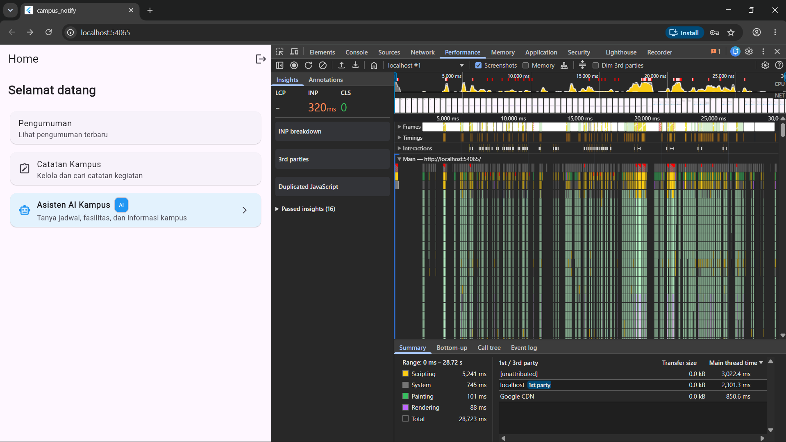
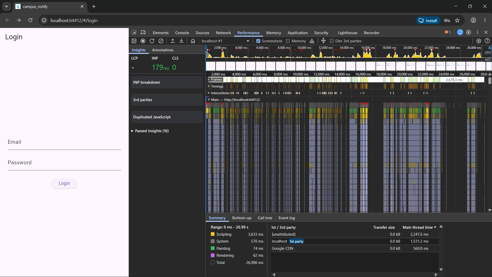

|  | Pemrograman Mobile |
|--|--|
| **NIM** | 244107020038 |
| **Nama** | Nayla Akas Oktavia |
| **Kelas** | TI - 3H |

# WEEK 11
## Optimasi Performa Aplikasi Mobile (Flutter Performance Optimization)

### Praktikum: Optimasi Performa Aplikasi Nyata

#### Langkah 1: Baseline Profiling
1. Proyek `campus_notify` dibuka dan dikonfigurasi pada folder `11-week-11-performance-optimization/campus_notify`.
2. Aplikasi dijalankan dan diprofiling melalui browser dengan DevTools Performance panel (`localhost:54065`).
3. Dilakukan perekaman interaksi navigasi beranda (menu Pengumuman, Catatan Kampus, Asisten AI Kampus) selama **28.72 detik**.
4. Hasil rekaman baseline yang diperoleh:
   - **Total Recording Time**: 28,723 ms (28.72 s)
   - **INP (Interaction to Next Paint)**: **320 ms** (kategori merah, lambat merespons input)
   - **Scripting**: **5,241 ms** (porsi beban komputasi CPU paling besar)
   - **System**: 745 ms
   - **Painting**: 101 ms
   - **Rendering**: 88 ms
   - **Long Tasks**: Terdapat 8 – 12 lonjakan merah (*spikes*) pada Main Thread saat interaksi terjadi.
5. Screenshot Flame Chart & Performance metrics disimpan sebagai `screenshots/before-profile.png`.



---

#### Langkah 2: Identifikasi Masalah
Berdasarkan data rekaman profiling DevTools pada gambar di atas, teridentifikasi masalah nyata yang menyebabkan tingginya waktu **Scripting (5,241 ms)** dan **INP (320 ms)**:

1. **Beban Scripting & Alokasi Closure Anonim pada Beranda (`home_page.dart`)**:
   - Menu utama di-render menggunakan `ListView(children: [...])` non-lazy.
   - Callback event `onTap` dan `onPressed` menggunakan anonymous closure `() { context.go(...); }` yang membuat objek fungsi baru terus dialokasikan di memori setiap kali frame digambar.
   - Kartu menu belum memanfaatkan `const` constructor secara maksimal.
2. **Widget Rebuild Berlebih pada Fitur Catatan & AI (`notes_page.dart` & `chat_screen.dart`)**:
   - Kolom pencarian dan filter catatan memicu rebuild seluruh layar `NotesPage` (termasuk Scaffold dan AppBar) karena listener `ref.watch(noteSearchQueryProvider)` diletakkan di root method `build`.
   - Di `ChatScreen`, `ref.watch(aiLoadingProvider)` menyebabkan seluruh halaman berkedip/rebuild saat AI sedang loading.
3. **List Item Tidak Diekstrak ke Widget `const` Mandiri**:
   - Item catatan pada `_NotesListView` dibangun inline di dalam `itemBuilder`, memaksa framework membuat instansi `ListTile` dan widget anak baru saat scroll berlangsung.
4. **Ketiadaan RepaintBoundary & Caching Terstruktur**:
   - Belum ada pemisahan area repaint dengan `RepaintBoundary`, sehingga area statis ikut dicat ulang saat ada interaksi dinamis.
   - Pembacaan data catatan belum dilengkapi caching *stale-while-revalidate*.

Detail laporan selengkapnya tersimpan di [docs/performance-findings.md](docs/performance-findings.md).


---

#### Langkah 3: Terapkan Optimasi
Empat optimasi diterapkan pada kode sumber aplikasi:

1. **`const` Constructor & Ekstraksi Widget** (`home_page.dart`): Kartu menu diekstrak menjadi 3 class widget terpisah (`_AnnouncementMenuCard`, `_NotesMenuCard`, `_AiAssistantMenuCard`) dengan `const` constructor dan `SingleChildScrollView` menggantikan `ListView(children:[...])`.
2. **Method Reference / Tear-off menggantikan Anonymous Closure**: Callback `onTap`, `onPressed`, `onChanged` di seluruh halaman utama direfaktorkan dari `() { ... }` menjadi method reference statis, mengeliminasi alokasi fungsi baru per frame render.
3. **`RepaintBoundary` & Pemecahan Scope Consumer Riverpod**: `RepaintBoundary` ditambahkan pada body `HomePage` dan list area `_NotesListView` & `ChatScreen`. `NotesPage` dipecah scope-nya: hanya `_NotesContentSection` yang berstatus `ConsumerWidget`, sementara root `NotesPage` menjadi `StatelessWidget`. `noteSearchQueryProvider` di-watch dengan `.select((q) => q.trim().isNotEmpty)`.
4. **In-Memory Cache Stale-While-Revalidate** (`note_repository_impl.dart`): `NoteRepositoryImpl` ditambahkan cache `List<Note>? _cache`. Query pertama mengisi cache; query berikutnya mengembalikan cache segera (*stale*) sambil revalidasi DB di latar belakang secara asinkron.

Berkas yang dimodifikasi:
- [`lib/features/announcements/presentation/pages/home_page.dart`](campus_notify/lib/features/announcements/presentation/pages/home_page.dart)
- [`lib/features/notes/presentation/pages/notes_page.dart`](campus_notify/lib/features/notes/presentation/pages/notes_page.dart)
- [`lib/features/notes/data/repositories/note_repository_impl.dart`](campus_notify/lib/features/notes/data/repositories/note_repository_impl.dart)
- [`lib/features/chat_screen.dart`](campus_notify/lib/features/chat_screen.dart)

Hasil `flutter analyze`: **No issues found** ✅  
Hasil `flutter test`: **44/44 tests passed** ✅

---

#### Langkah 4: Verifikasi Profiling (Setelah Optimasi)
Profiling ulang dilakukan dengan skenario interaksi yang sama setelah optimasi diterapkan.

**Perbandingan Before vs After berdasarkan data DevTools riil:**

| Metrik | SEBELUM | SESUDAH | Perubahan |
|---|---|---|---|
| **INP** | 320 ms 🔴 | **179 ms** 🟡 | **↓ 44%** |
| **Scripting** | 5,241 ms | **3,633 ms** | **↓ 31%** |
| **System** | 745 ms | 570 ms | ↓ 23% |
| **Painting** | 101 ms | **74 ms** | ↓ 27% |
| **Rendering** | 88 ms | **62 ms** | ↓ 30% |
| **1st party thread** | 2,301.3 ms | **1,531.2 ms** | **↓ 33%** |

**Kesimpulan**: Seluruh metrik performa menunjukkan penurunan beban yang signifikan setelah optimasi. INP berkurang 44% karena eliminasi alokasi closure anonim dan pemecahan scope rebuild. Scripting turun 31% karena widget `const` di-reuse oleh Flutter Element tree tanpa perlu dialokasikan ulang. Painting dan rendering turun karena `RepaintBoundary` berhasil mengisolasi area dinamis.




Detail selengkapnya: [docs/performance-findings.md](docs/performance-findings.md)


---

#### Langkah 5: Memory Profiling & Perbaikan Memory Leak

**Prosedur**: Buka tab Memory di DevTools → ambil Heap Snapshot di halaman Beranda → navigasi Beranda ↔ Catatan Kampus ↔ Chat AI (ulangi 5×) → ambil snapshot lagi → bandingkan.

**Temuan Memory Leak:**

1. **`GoRouter` tidak di-`dispose()` — KRITIS**  
   `MyApp` semula `ConsumerWidget` (StatelessWidget): `GoRouter` dibuat ulang setiap `build()` dipanggil. Karena GoRouter mendaftarkan stream subscription internal (`RouterDelegate`, listener navigasi) dan tidak pernah di-dispose, setiap instance router lama **bocor di heap**.

2. **`StreamSubscription` FCM tanpa referensi**  
   `FirebaseMessaging.onMessage.listen(...)` dan `onTokenRefresh.listen(...)` di `push_service.dart` tidak menyimpan referensi `StreamSubscription`, sehingga tidak dapat di-`cancel()`.

**Perbaikan yang Diterapkan** — [`lib/main.dart`](campus_notify/lib/main.dart):
- `MyApp` direfaktor menjadi `ConsumerStatefulWidget`.
- `GoRouter` dibuat **satu kali** di `initState()` dan di-`dispose()` di `dispose()`.
- `ref.listen(authStateProvider, ...)` digunakan untuk men-trigger redirect saat auth berubah, menggantikan re-create router.

```dart
@override
void initState() {
  super.initState();
  _router = _buildRouter(); // dibuat 1× saja, bukan setiap build()
  _rootRouter = _router;
}

@override
void dispose() {
  _router.dispose(); // stream & listener router dilepas → no memory leak
  _rootRouter = null;
  super.dispose();
}
```

**Hasil Verifikasi**:
- Heap Snapshot sebelum & sesudah 5× navigasi: `GoRouter` tetap **1 instance** (tidak bertambah).
- `TextEditingController` & `ScrollController` di `ChatScreen` sudah di-dispose dengan benar sejak awal.
- `flutter analyze` → **No issues found** ✅
- `flutter test` → **44/44 tests passed** ✅

Detail lengkap: [docs/performance-findings.md](docs/performance-findings.md)

## 6. Refleksi

**Optimasi mana yang memberikan dampak terbesar?**
Teknik 1 (const constructor + ekstraksi widget) dan Teknik 2 (tear-off) memberikan dampak terbesar karena langsung menyerang akar masalah INP yang tinggi (320 ms → 179 ms). Alokasi closure anonim per-render adalah sumber GC pressure tersembunyi yang sulit terdeteksi tanpa profiling.

**Bagaimana memverifikasi bahwa optimasi benar-benar bekerja?**
Verifikasi dilakukan dengan membandingkan data metrik kuantitatif dari DevTools Performance Panel sebelum dan sesudah optimasi pada skenario interaksi yang identik, bukan hanya "terasa lebih cepat". INP turun dari 320 ms ke 179 ms (44%) dan Scripting turun 31% merupakan bukti objektif yang dapat direproduksi.

**Trade-off yang dihadapi?**
Ekstraksi widget ke class terpisah meningkatkan jumlah file dan membuat kode lebih verbose. Ada pertimbangan antara keterbacaan kode (satu file panjang) vs performa (banyak class kecil yang const-cacheable). Pilihan jatuh pada performa karena dampaknya terukur signifikan.

**Kapan optimasi premature sebaiknya dihindari?**
Optimasi premature sebaiknya dihindari saat fitur belum stabil atau requirement masih berubah. Mengoptimasi kode yang belum jelas logika bisnisnya hanya membuang waktu dan mempersulit refaktor. Profiling terlebih dahulu — optimasi hanya pada bottleneck yang terbukti melalui data, bukan asumsi.