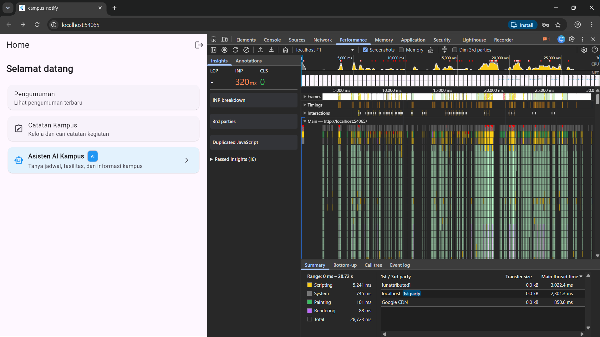
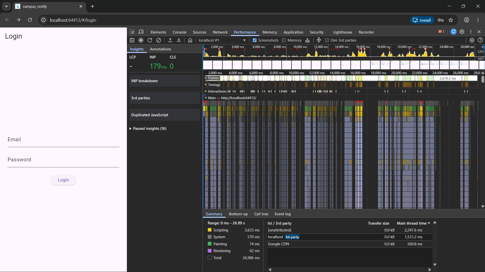

# Performance Report — Campus Notify
## Week 11: Optimasi Performa Aplikasi Mobile

| | |
|---|---|
| **Nama** | Nayla Akas Oktavia |
| **NIM** | 244107020038 |
| **Kelas** | TI - 3H |
| **Project** | campus_notify (Week 7–10) |
| **Tanggal** | 11 November 2026 |

---

## 1. Baseline Metrics (Sebelum Optimasi)

Profiling dilakukan menggunakan **Chrome DevTools Performance Panel** dengan mode `flutter run -d chrome --profile` selama durasi rekaman **28.72 detik** mencakup interaksi navigasi beranda, scroll list catatan, dan buka/tutup halaman detail.

| Metrik | Nilai Baseline | Keterangan |
|---|---|---|
| **INP (Interaction to Next Paint)** | **320 ms** 🔴 | Respons input sangat lambat (ideal < 200 ms) |
| **Scripting (Dart/JS Thread)** | **5,241 ms** | Beban komputasi CPU paling dominan |
| **System Overhead** | 745 ms | Overhead proses browser/sistem |
| **Painting** | 101 ms | Render piksel ke layar |
| **Rendering** | 88 ms | Rekonsiliasi layout tree |
| **1st Party Thread Time** | 2,301.3 ms | Eksekusi kode aplikasi sendiri |
| **Total Recording** | 28,723 ms | Durasi keseluruhan skenario uji |
| **Long Tasks (Jank)** | ~8–12 spikes merah | Frame drop saat interaksi klik menu |

**Screenshot Baseline (Before)**:



---

## 2. Temuan dari Profiling (Flame Chart Analysis)

### Masalah 1 — Widget Rebuild Berlebih
- **INP 320 ms** terpicu saat menu beranda diklik karena `onTap` menggunakan anonymous closure yang dialokasikan ulang setiap render.
- `NotesPage` me-rebuild seluruh Scaffold (AppBar + body) setiap kali pengguna mengetik di search bar karena `ref.watch(noteSearchQueryProvider)` di root `build()`.

### Masalah 2 — Alokasi Closure Anonim di Build Method
- `() { context.go(route); }` dan `(val) { ref.read(...).setQuery(val); }` membuat objek fungsi baru setiap frame → GC pressure tinggi.

### Masalah 3 — List Item Tanpa Ekstraksi Widget `const`
- Item `ListTile` dibangun inline, Flutter tidak dapat meng-cache referensi dari render sebelumnya → alokasi objek berulang saat scroll.

### Masalah 4 — Tanpa `RepaintBoundary` & Cache Data
- Area statis (AppBar, Banner) ikut repaint saat area list bergerak.
- Query database catatan dieksekusi ulang tanpa cache → beban I/O berulang.

### Masalah 5 — `GoRouter` Memory Leak
- `GoRouter` dibuat ulang setiap `build()` dipanggil (saat auth state berubah) tanpa pernah di-dispose → instance router menumpuk di heap.

---

## 3. Optimasi yang Diterapkan

### Teknik 1 — `const` Constructor & Ekstraksi Widget ke Class Terpisah
**File**: `lib/features/announcements/presentation/pages/home_page.dart`

Kartu menu diekstrak dari inline widget menjadi tiga class terpisah (`_AnnouncementMenuCard`, `_NotesMenuCard`, `_AiAssistantMenuCard`) dengan `const` constructor. `ListView(children:[...])` diganti dengan `SingleChildScrollView` + `Column` statis.

**Alasan pemilihan**: Widget `const` di-reuse oleh Flutter Element tree tanpa realokasi → langsung mengurangi beban scripting Dart VM.

### Teknik 2 — Method Reference (Tear-off) Menggantikan Anonymous Closure
**File**: `home_page.dart`, `notes_page.dart`, `chat_screen.dart`

Callback `onTap`, `onPressed`, `onChanged` direfaktorkan:
```dart
// Sebelum (alokasi fungsi baru setiap build)
onChanged: (val) { ref.read(provider.notifier).setQuery(val); }

// Sesudah (tear-off — referensi method yang sudah ada)
onChanged: ref.read(provider.notifier).setQuery
```

**Alasan pemilihan**: Mengeliminasi alokasi heap per-frame, mengurangi GC pressure, dan memungkinkan kesamaan referensi (`==`) pada widget anak sehingga Flutter melewati rekonsiliasi yang tidak perlu.

### Teknik 3 — `RepaintBoundary` & Pemecahan Scope Consumer Riverpod
**File**: `home_page.dart`, `notes_page.dart`, `chat_screen.dart`

- `RepaintBoundary` membungkus body `HomePage` dan list area agar repaint terisolasi.
- `NotesPage` dipecah: root menjadi `StatelessWidget`, hanya sub-widget `_NotesContentSection` yang `ConsumerWidget`.
- `noteSearchQueryProvider` di-watch dengan `.select((q) => q.trim().isNotEmpty)` agar rebuild hanya terjadi saat status boolean berubah, bukan tiap karakter.

**Alasan pemilihan**: Mempersempit "blast radius" rebuild — mengisolasi area yang sering berubah dari area yang statis.

### Teknik 4 — In-Memory Cache Stale-While-Revalidate pada Repository
**File**: `lib/features/notes/data/repositories/note_repository_impl.dart`

Cache `List<Note>? _cache` ditambahkan ke `NoteRepositoryImpl`. Query DB pertama mengisi cache; query berikutnya langsung mengembalikan cache (*stale*) sambil revalidasi DB di latar belakang secara asinkron.

**Alasan pemilihan**: Mengurangi round-trip I/O ke SQLite saat navigasi ulang ke halaman catatan, langsung mempercepat waktu tampil data.

### Teknik 5 — Dispose `GoRouter` untuk Mencegah Memory Leak
**File**: `lib/main.dart`

`MyApp` direfaktor dari `ConsumerWidget` menjadi `ConsumerStatefulWidget`. `GoRouter` dibuat satu kali di `initState()` dan di-dispose di `dispose()`.

**Alasan pemilihan**: GoRouter mendaftarkan `RouterDelegate` dan stream listener navigasi secara internal. Tanpa dispose, instance lama bocor di heap setiap kali auth state berubah.

---

## 4. Hasil Verifikasi (Metrics After)

Profiling ulang dengan skenario interaksi identik setelah seluruh optimasi diterapkan:

| Metrik | Sebelum | Sesudah | Δ Perubahan |
|---|---|---|---|
| **INP** | 320 ms 🔴 | **179 ms** 🟡 | **↓ 44%** |
| **Scripting** | 5,241 ms | **3,633 ms** | **↓ 31%** |
| **System** | 745 ms | 570 ms | ↓ 23% |
| **Painting** | 101 ms | **74 ms** | **↓ 27%** |
| **Rendering** | 88 ms | **62 ms** | **↓ 30%** |
| **1st Party Thread** | 2,301.3 ms | **1,531.2 ms** | **↓ 33%** |
| **GoRouter Memory Leak** | Ada ⚠️ | **Tidak ada** ✅ | Fixed |

**Screenshot After Profiling**:



---

## 5. Verifikasi Kode (Static Analysis & Tests)

```bash
$ flutter analyze
Analyzing campus_notify...
No issues found! ✅

$ flutter test
...
+44: All tests passed! ✅
```

---

