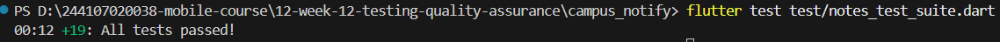
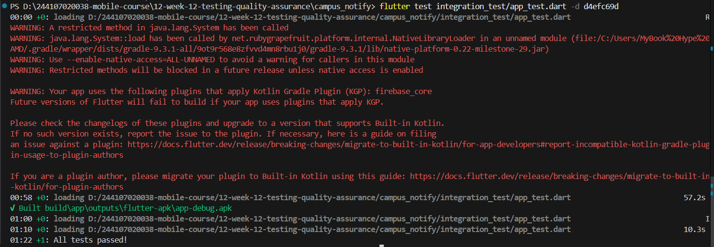
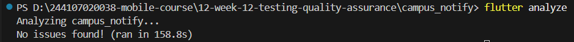

|  | Pemrograman Mobile |
|--|--|
| **NIM** | 244107020038 |
| **Nama** | Nayla Akas Oktavia |
| **Kelas** | TI - 3H |

# WEEK 12
## Pengujian dan Jaminan Kualitas

### Langkah 1 — Catat Perilaku

Sebelum menulis kode pengujian, saya mencatat perilaku yang penting bagi pengguna pada fitur Notes:

| No | Skenario | Jenis | Hasil yang Diharapkan |
|----|----------|-------|-----------------------|
| 1 | Pengguna mengetik judul catatan yang valid | Happy path | `validateTitle()` mengembalikan `true` |
| 2 | Pengguna mengirim judul kosong atau hanya spasi | Edge case | `validateTitle()` mengembalikan `false` |
| 3 | Pengguna mencari catatan berdasarkan judul | Happy path | Hanya catatan yang cocok yang ditampilkan (case-insensitive) |
| 4 | Pencarian tidak menemukan hasil | Edge case | Daftar kosong dikembalikan |
| 5 | Repository gagal mengambil data (error jaringan/DB) | Kegagalan | Failure dikembalikan, bukan exception yang di-throw |

---

### Langkah 2 — Uji Logika (Unit Test)

Membuat unit test untuk dua use case bisnis utama menggunakan `group()`:

**File:** `test/notes_test_suite.dart`

**Group `AddNotes`** — Validasi judul catatan:
- ✅ Menerima judul yang berisi teks
- ✅ Menerima judul dengan spasi di awal/akhir
- ❌ Menolak judul kosong (`''`)
- ❌ Menolak judul yang hanya berisi spasi (`'   '`)

**Group `SearchNotes`** — Filter catatan berdasarkan query:
- ✅ Mengembalikan semua catatan jika query kosong
- ✅ Mengembalikan semua catatan jika query hanya spasi
- ✅ Memfilter berdasarkan judul, case-insensitive
- ✅ Memfilter berdasarkan sebagian judul
- ✅ Mengembalikan daftar kosong jika tidak ada yang cocok

---

### Langkah 3 — Uji Dependensi (Fake Repository)

Memisahkan akses data dari logika bisnis menggunakan `FakeNoteRepository` yang mengimplementasikan `NoteRepository`:

```dart
class FakeNoteRepository implements NoteRepository {
  FakeNoteRepository({this.notes = const [], this.error});
  final List<Note> notes;
  final Exception? error;

  @override
  Future<({List<Note> notes, Failure? failure})> fetchNotes() async {
    if (error != null) {
      return (notes: const <Note>[], failure: LocalFailure(error.toString()));
    }
    return (notes: notes, failure: null);
  }
  // ... addNote implementation
}
```

**Test yang ditulis:**
- ✅ `GetNotes` meneruskan data dari repository (data sukses)
- ✅ `GetNotes` meneruskan failure tanpa throw (data gagal)
- ✅ `addNote` berhasil mengembalikan note baru
- ✅ `addNote` gagal jika judul kosong

---

### Langkah 4 — Uji UI (Widget Test)

Menguji tampilan `NotesPage` menggunakan `ProviderScope` dengan override fake repository:

```dart
Widget buildTestApp({required FakeNoteRepository repository}) {
  return ProviderScope(
    overrides: [
      noteRepositoryProvider.overrideWithValue(repository),
    ],
    child: const MaterialApp(home: NotesPage()),
  );
}
```

**Test yang ditulis:**
- ✅ Search bar tampil di halaman
- ✅ Pesan "Belum ada catatan." muncul saat data kosong
- ✅ Daftar catatan tampil dengan data
- ✅ Search memfilter hasil catatan
- ✅ Tombol clear muncul saat ada query
- ✅ Tombol clear mengembalikan semua catatan

---

### Langkah 5 — Uji Alur Utama (Integration Test)

Menulis satu pengujian integrasi yang menguji alur penting dari awal hingga akhir:

**File:** `integration_test/app_test.dart`

**Alur yang diuji:** Buka halaman Notes → Lihat semua catatan → Cari "Algoritma" → Verifikasi filter → Tap Clear → Verifikasi semua catatan kembali

```dart
IntegrationTestWidgetsFlutterBinding.ensureInitialized();

testWidgets('alur utama: buka notes → cari → clear', (tester) async {
  await tester.pumpWidget(/* app dengan fake data */);
  await tester.pumpAndSettle();

  // Verifikasi semua catatan tampil
  // Ketik query pencarian
  // Verifikasi filter bekerja
  // Tap clear
  // Verifikasi semua catatan kembali
});
```

---

### Langkah 6 — Jalankan Semua Pemeriksaan

Perintah yang dijalankan:

```bash
# Unit + Widget test
flutter test test/notes_test_suite.dart

# Semua test
flutter test

# Integration test pada perangkat
flutter test integration_test/app_test.dart -d <device_id>

# Analisis statis
flutter analyze
```

**Hasil:**

#### 1. Unit Test & Widget Test



#### 2. Integration Test



#### 3. Analisis Statis



---

### Mini Project / Industry Challenge

1. **Fitur yang diuji:** Notes (Catatan Kampus)

2. **Skenario perilaku yang dicatat (Langkah 1):**

| No | Skenario | Jenis | Hasil yang Diharapkan |
|----|----------|-------|-----------------------|
| 1 | Judul valid | Happy path | `validateTitle()` → `true` |
| 2 | Judul kosong/spasi | Edge case | `validateTitle()` → `false` |
| 3 | Cari catatan berdasarkan judul | Happy path | Catatan yang cocok ditampilkan |
| 4 | Pencarian tidak ada hasil | Edge case | Daftar kosong |
| 5 | Repository error | Kegagalan | Failure dikembalikan, bukan throw |

3. **File test yang dibuat:**
   - `test/notes_test_suite.dart` — Unit test (AddNotes, SearchNotes), dependency test (FakeNoteRepository + GetNotes), widget test (NotesPage)
   - `integration_test/app_test.dart` — Integration test alur utama pencarian

4. **Cara menjalankan:**
   ```bash
   flutter test test/notes_test_suite.dart
   flutter test
   flutter test integration_test/app_test.dart -d <device_id>
   flutter analyze
   ```

5. **Sertakan screenshot `flutter test` + `flutter analyze` bersih di README.**
   *(Telah disertakan lengkap pada sub-bab **Langkah 6 — Jalankan Semua Pemeriksaan** di atas).*

6. **Push ke `12-week-12-testing-quality-assurance/` berisi `lib/`, `test/`, `integration_test/`, `README.md`, `screenshots/`.**

### Refleksi

1. **Bagian mana dari pengujian yang paling membantu menemukan bug?**
   Unit test pada `AddNotes.validateTitle()` paling membantu karena langsung mengungkap edge case judul hanya berisi spasi yang sering terlewat saat coding manual.

2. **Apakah widget test memberi keyakinan lebih dibanding manual test?**
   Ya. Widget test bisa diulang otomatis setiap kali ada perubahan kode, sehingga regresi langsung terdeteksi tanpa harus buka aplikasi dan klik manual berkali-kali.

3. **Apa tantangan dalam menulis test yang baik?**
   Tantangan utama adalah menyiapkan fake/mock yang sesuai dengan interface repository, terutama mencocokkan signature method dan record type Dart 3. Selain itu, menentukan skenario edge case yang realistis membutuhkan pemahaman domain yang dalam.

4. **Kapan sebaiknya integration test dipilih dibanding unit test?**
   Integration test dipilih saat ingin memverifikasi alur end-to-end yang melibatkan beberapa komponen sekaligus (UI + provider + use case). Namun karena lebih lambat, cukup tulis untuk alur kritis saja dan gunakan unit test untuk logika detail.
