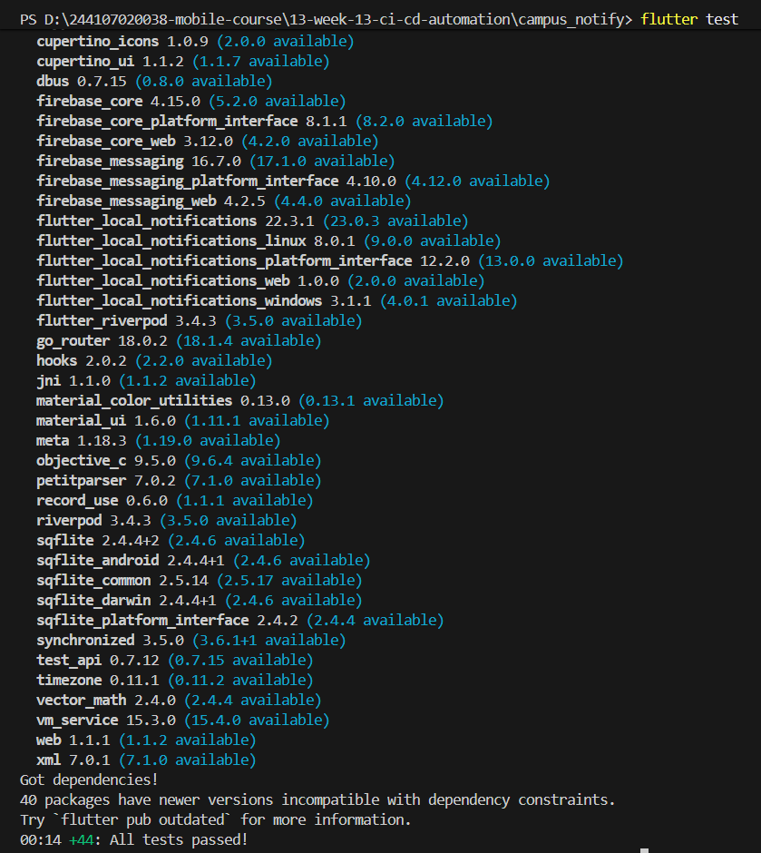
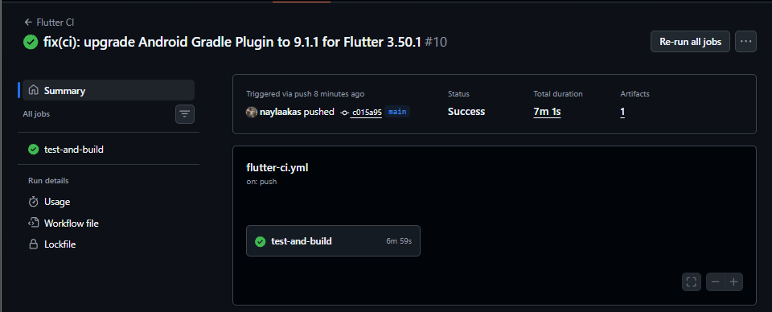
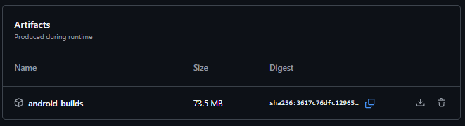

# Week 13 – CI/CD Automation

| Field | Value |
|-------|-------|
| **NIM** | 244107020038 |
| **Nama** | Nayla Akas Oktavia |
| **Kelas** | TI-3H |
| **Mata Kuliah** | Pemrograman Mobile |
| **Topik** | CI/CD Automation dengan GitHub Actions |

---

## Langkah 3 – Membuat Workflow CI Flutter

### 1. Tambahkan File Workflow

Buat file `.github/workflows/flutter-ci.yml` di root repository:

```yaml
name: Flutter CI

on:
  push:
    branches: [main]
  pull_request:
    branches: [main]
  workflow_dispatch:

permissions:
  contents: read

concurrency:
  group: ${{ github.workflow }}-${{ github.ref }}
  cancel-in-progress: true

jobs:
  test-and-build:
    runs-on: ubuntu-latest
    defaults:
      run:
        working-directory: 13-week-13-ci-cd-automation/campus_notify

    steps:
      - uses: actions/checkout@v4

      - uses: actions/setup-java@v4
        with:
          distribution: 'zulu'
          java-version: '17'

      - uses: subosito/flutter-action@v2
        with:
          channel: stable
          cache: true

      - name: Install Dependencies
        run: flutter pub get

      - name: Verify Code Formatting
        run: dart format --output=none --set-exit-if-changed .

      - name: Analyze Project (Linter)
        run: flutter analyze --fatal-infos

      - name: Run Tests with Coverage
        run: flutter test --coverage
```

**Penjelasan langkah-langkah:**
- `flutter pub get` – mengunduh semua dependensi yang didefinisikan di `pubspec.yaml`.
- `dart format` – memastikan seluruh kode mengikuti format Dart standar.
- `flutter analyze --fatal-infos` – menjalankan static analysis dan menggagalkan pipeline bila ada isu.
- `flutter test --coverage` – menjalankan semua unit dan widget test, menghasilkan laporan cakupan.

### 2. Periksa Secara Lokal

Sebelum push, jalankan perintah yang sama di terminal:

```bash
cd 13-week-13-ci-cd-automation/campus_notify
dart format --output=none --set-exit-if-changed .
flutter analyze --fatal-infos
flutter test --coverage
```

### Screenshot – Pemeriksaan Lokal



---

## Langkah 4 – Membangun dan Menyimpan APK/AAB

### 1. Tambahkan Langkah Build

Setelah test lulus, tambahkan step berikut ke job yang sama:

```yaml
      - name: Build APK (Release)
        run: flutter build apk --release

      - name: Build App Bundle (Release)
        run: flutter build appbundle --release

      - name: Upload Build Artifacts
        uses: actions/upload-artifact@v4
        with:
          name: android-builds
          path: |
            13-week-13-ci-cd-automation/campus_notify/build/app/outputs/flutter-apk/app-release.apk
            13-week-13-ci-cd-automation/campus_notify/build/app/outputs/bundle/release/app-release.aab
          if-no-files-found: error
          retention-days: 7
```

**Keterangan:**
- **APK** (`app-release.apk`) – praktis untuk instalasi dan uji internal langsung di perangkat.
- **AAB** (`app-release.aab`) – format distribusi untuk Google Play Store.
- **Artifact** – disimpan selama 7 hari dan dapat diunduh dari halaman run di tab **Actions**.

> [!WARNING]
> Build sukses tidak otomatis berarti siap dipublikasikan. Signing, konfigurasi izin, dan pengujian perangkat tetap perlu ditinjau sebelum rilis ke Play Store.

---

## Langkah 5 – Versi, Secrets, dan Keamanan

### 1. Versioning

Versi aplikasi diatur di `pubspec.yaml`:

```yaml
version: 1.1.0+2
```

Format: `<major>.<minor>.<patch>+<build_number>`
- **1.1.0** = versi aplikasi (semantic versioning)
- **+2** = build number (dinaikkan setiap build/upload baru)

**Aturan semantic versioning:**
- `major` – perubahan tidak kompatibel (breaking changes)
- `minor` – fitur baru yang kompatibel ke belakang
- `patch` – perbaikan bug kecil

Gunakan tag seperti `v1.1.0` untuk menghubungkan source code, log pipeline, dan artefak.

### 2. Rahasia dan Konfigurasi

- Simpan token privat, password, dan material signing melalui **GitHub Actions Secrets** (Settings → Secrets and variables → Actions), bukan di repository.
- Jangan mencetak secret ke log atau mengirimkannya ke proses yang tidak dipercaya.
- URL API dan nama environment konfigurasi publik (bukan credential) boleh disimpan di repository.
- Nilai yang diteruskan lewat `--dart-define` dapat diekstrak dari aplikasi klien — jangan gunakan untuk secret produksi.

> [!CAUTION]
> Jangan menaruh keystore produksi pada workflow pull request. Gunakan workflow rilis terpisah yang dibatasi hanya berjalan pada branch utama atau tag rilis.

---

## Langkah 6 – Menjalankan dan Mengevaluasi Pipeline

### 1. Cara Menjalankan Workflow

1. Commit semua file dan push ke branch `main`:
   ```bash
   git add .
   git commit -m "feat(ci): Week 13 CI/CD pipeline"
   git push origin main
   ```
2. Buka tab **Actions** di repository GitHub.
3. Pilih run yang sesuai dan tinjau setiap step.
4. Pastikan kegagalan test membuat job gagal (merah ✗).
5. Unduh artefak (APK/AAB) dari bagian **Artifacts** di bawah halaman run.

### Screenshot – GitHub Actions Run (Semua Step Hijau)



### Screenshot – Artifacts Tersimpan



---

## Tugas

1. **Tambahkan workflow CI** ke project Flutter dengan format, analisis, dan test → selesai (`.github/workflows/flutter-ci.yml`).
2. **Bangun APK dan AAB** serta simpan keduanya sebagai artefak → workflow menghasilkan `android-builds` yang dapat diunduh dari halaman Actions.
3. **Jalankan workflow** melalui push ke branch `main`; commit pemicu: `feat(ci): Week 13 CI/CD pipeline with Flutter test and Android build`.
4. **Dokumentasi versi**: versi saat ini `1.1.0+2`, pemeriksaan yang dijalankan: format → analyze → test → build APK → build AAB, risiko keamanan yang masih perlu ditangani: signing key belum dikonfigurasi (perlu keystore di Secrets untuk rilis Play Store).

---

## Refleksi

**1. Masalah apa yang ditemukan otomatis sebelum perubahan di-merge?**  
GitHub Actions mendeteksi kegagalan `flutter analyze --fatal-infos` akibat penggunaan `package:flutter/material.dart` yang sudah deprecated di versi Flutter terbaru. Masalah ini tidak terdeteksi secara manual dan langsung menghentikan pipeline sebelum kode sempat di-merge.

**2. Informasi apa yang dibutuhkan untuk menyelidiki build yang gagal?**  
Log step "Analyze Project (Linter)" dan "Run Tests" di tab Actions menunjukkan baris mana yang bermasalah beserta nama file dan nomor baris. Informasi ini cukup untuk mereproduksi kegagalan secara lokal dengan menjalankan perintah yang sama.

**3. Bagian mana yang masih perlu persetujuan atau pemeriksaan manual sebelum rilis?**  
Signing APK/AAB (keystore), pengujian di perangkat fisik, konfigurasi izin aplikasi (permissions), dan review kode oleh rekan tim masih memerlukan tindakan manual sebelum aplikasi layak diterbitkan ke Play Store.

---

*Praktikum Pemrograman Mobile – Politeknik Negeri Indramayu – 2026*
